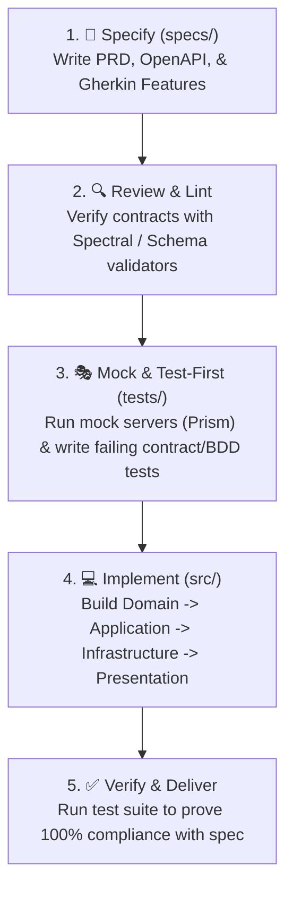

# 🏗️ Software Architecture Project - Spec-Driven Development (Spec-First)

This project is structured specifically for **Spec-Driven Development (SDD)** using a **Spec-First** methodology.

In a Spec-First workflow, **specifications, API contracts, domain models, and acceptance tests are defined and approved before writing production code**.

---

## 📁 Project Directory Structure

```text
.
├── specs/                          # 🌟 Single Source of Truth (SSOT)
│   ├── contracts/                  # Formal API Contracts & XSD Schemas (UBL 2.1 / SUNAT)
│   │   ├── api.yaml                # Standardized REST API Contract (RS 097-2012 / RS 234-2006)
│   │   └── UBL-Invoice-2.1.xsd     # Official OASIS UBL-Invoice-2.1 XML Schema Definition
│   ├── adr/                        # Architecture Decision Records
│   │   └── 0001-arquitectura-mvc-hexagonal.md
│   ├── features/                   # Domain & Migration Specifications
│   │   ├── casos-de-uso.md         # Formal Use Cases (Nubefact Benchmark)
│   │   ├── dominio-migracion.md    # Legacy to UBL-Invoice-2.1 mapping
│   │   └── matriz-trazabilidad-ubl-sunat.md # SUNAT vs UBL 2.1 Traceability Matrix
│   ├── api/                        # General API specifications
│   │   └── openapi.yaml
│   ├── requirements/               # Functional & Non-Functional Specifications
│   │   ├── functional-requirements.md
│   │   └── non-functional-requirements.md
│   ├── data-models/                # Domain schemas & entity definitions
│   │   ├── schemas/item.schema.json
│   │   └── README.md
│   ├── acceptance/                 # BDD executable specifications (Gherkin)
│   │   ├── features/example.feature
│   │   └── README.md
│   ├── templates/                  # Templates for new features and changes
│   │   └── feature-spec.template.md
│   └── README.md                   # Principles of Spec-First development
│
├── src/                            # 💻 Production Code (Clean / Hexagonal Architecture)
│   ├── domain/                     # Entities, Value Objects, Repository Interfaces (Ports)
│   ├── application/                # Use Cases, DTOs, Application Services
│   ├── infrastructure/             # Database adapters, External API clients, Persistence
│   └── presentation/               # API Controllers, Route Handlers, Middlewares
│
├── tests/                          # 🧪 Spec-Aligned Testing Suite
│   ├── unit/                       # Unit tests for domain logic
│   ├── integration/                # Integration tests (Use cases + Infrastructure)
│   ├── contract/                   # Automated API contract tests against specs/api/
│   └── acceptance/                 # BDD acceptance tests executing specs/acceptance/
│
├── docs/                           # 📚 Architecture Overviews & Diagrams
│   └── architecture.md
│
├── .editorconfig                   # Consistent code indentation & formatting
└── .gitignore                      # Ignore patterns for modern multi-language stacks
```

---

## 🔄 Spec-First Lifecycle

When implementing any new feature or modifying existing behavior, follow this 5-stage lifecycle:



---

## 🛠️ Recommended Spec-First Tooling

| Capability | Recommended Tool | Command Example |
|:---|:---|:---|
| **Contract Linting** | [Spectral](https://stoplight.io/open-source/spectral) | `npx @stoplight/spectral-cli lint specs/api/openapi.yaml` |
| **Instant Mock Server** | [Prism](https://stoplight.io/open-source/prism) | `npx @stoplight/prism-cli mock specs/api/openapi.yaml` |
| **API Contract Testing** | [Dredd](https://dredd.org) / [Schemathesis](https://schemathesis.readthedocs.io) | `npx dredd specs/api/openapi.yaml http://localhost:8080` |
| **Acceptance / BDD** | Cucumber / Behave / SpecFlow | Run scenarios against `specs/acceptance/features/` |
| **Architecture Documentation** | Mermaid / C4-PlantUML | Rendered directly in GitHub/GitLab markdown |

---

## 🚀 Getting Started

1. **Review Existing Specs**:
   - Explore [`specs/requirements/functional-requirements.md`](specs/requirements/functional-requirements.md)
   - Inspect the API contract in [`specs/api/openapi.yaml`](specs/api/openapi.yaml)
   - Read the architectural foundation in [`specs/adrs/0001-record-architecture-decisions.md`](specs/adrs/0001-record-architecture-decisions.md)
2. **Propose a Feature**:
   - Copy [`specs/templates/feature-spec.template.md`](specs/templates/feature-spec.template.md)
   - Define contracts and acceptance criteria before writing code.
3. **Implement**:
   - Code inside [`src/`](src/) respecting Clean Architecture layer separation.
