# 1. Análisis del caso

> **Rol asumido:** analista y líder técnico del equipo de desarrollo contratado por ABC Software Corp.
> **Fase:** primera fase, Spec-First. Se entregan reglas, contratos y especificaciones; todavía no se escribe lógica de negocio.

## 1.1 Lectura línea por línea del enunciado

Cada frase del enunciado se convirtió en un requisito verificable (`REQ-xx`) con el lugar del repositorio donde se atiende. Los requisitos `REQ-17` a `REQ-19` no están escritos en el enunciado, pero se deducen de él; se marcan como *derivados*.

**Tabla 1.1.** *Del enunciado a los requisitos*

| # | Fragmento del enunciado | Interpretación del analista | Requisito | Dónde se atiende |
|---|---|---|---|---|
| 1 | "empresa mediana que comercializa abarrotes y mercadería al por mayor y menor" | Hay dos canales de venta: el mayorista (facturas a RUC, volumen, crédito, bonificaciones de proveedores) y el minorista (boletas a consumidor final, efectivo, bolsas sujetas a ICBPER). Al ser una empresa mediana, es probable que esté obligada a llevar el Registro de Inventario Permanente y el SIRE. | REQ-01, REQ-17 | docs/03, docs/05 |
| 2 | "software operativo básico que cumple con lo justo y necesario para registrar el día a día del almacén" | El legado no vende ni factura: es un kárdex informal. El sistema nuevo debe integrar venta e inventario. | REQ-08, REQ-18 | docs/09 |
| 3 | "fichas sencillas con campos como fecha, ingreso, salida, producto y un número de documento interno bastante informal" | La calidad de los datos es baja: el número de documento no sigue el formato serie-número y el producto es texto libre. No hay unidades, precios ni clientes. Esos cinco campos coinciden casi uno a uno con el Formato 12.1 de la RS 234-2006. | REQ-08 | docs/09, Matriz C |
| 4 | "SUNAT, mediante la RS N.° 097-2012" | Corresponde al Sistema de Emisión Electrónica desde los sistemas del contribuyente: XML UBL, firma digital, envío y constancia de recepción (CDR). | REQ-01, REQ-05, REQ-06 | docs/02 |
| 5 | "RS N.° 234-2006" | Son las normas de libros y registros vinculados a asuntos tributarios: Formato 14.1 (Registro de Ventas) y Formato 12.1 (Inventario Permanente en Unidades Físicas). Hoy el Registro de Ventas se lleva en el SIRE. | REQ-02 | docs/02, Matrices B y C |
| 6 | "normativas modernas de masificación de comprobantes electrónicos" | Incluye la designación de emisores, la forma de pago (RS 193-2020), los cambios de catálogos (RS 000005-2023) y las reformas de 2026 (RS 000048, 000049, 000075, 000141 y 000143-2026). Los catálogos y las reglas deben ser **datos versionados**, no código. | REQ-09 | docs/02, ADR-08 |
| 7 | "les exige llevar registros formales y emitir comprobantes legales estructurados bajo [...] UBL" | Hay dos obligaciones distintas: registros formales y comprobantes UBL. | REQ-01, REQ-02 | docs/05 |
| 8 | "puede estudiar el estándar en la web de OASIS" | Se usaron los XSD oficiales de UBL 2.1 OS (2013), copiados sin cambios en `specs/ubl/xsd-oasis-ubl-2.1`. | REQ-07 | docs/02 |
| 9 | "no valida RUCs" | Brecha G-01. | REQ-03 | VAL-ID-* |
| 10 | "no calcula correctamente los impuestos (IGV, ISC, ICBPER, etc.)" | Brecha G-02. | REQ-04 | VAL-TRB-*, docs/04 |
| 11 | "no genera XMLs firmados digitalmente" | Brecha G-03. | REQ-05 | specs/ubl/ejemplos |
| 12 | "menos se comunica con un Operador de Servicios Electrónicos (OSE) o directamente con la SUNAT" | Brecha G-04. | REQ-06 | docs/07, sección 7.6 |
| 13 | "no es ponerte a codificar a lo que salga, sino mediante [...] Spec-First" | El orden de trabajo es: reglas, luego contratos, luego validación de los contratos, y recién después el código (Figura 1.1). | REQ-07 | todo el repositorio |
| 14 | "estudiando el archivo UBL-Invoice-2.1.xsd" | Se estudiaron la secuencia, las cardinalidades, los tipos y el punto de extensión de la firma. Encima del XSD va el perfil SUNAT (Anexo N.° 9-A). | REQ-07, REQ-16 | docs/02, Tabla 2.2 |
| 15 | "deberás estudiar todas las reglas antes, apoyándote de AI" | La investigación se hizo con apoyo de IA y se verificó contra fuentes primarias de SUNAT y OASIS (sección 1.6). | REQ-07 | docs/02, sección 2.9 |
| 16 | "acoplarse y mapearse limpiamente hacia las nuevas entidades del sistema sin perder trazabilidad" | Se usa staging inmutable, reglas de mapeo versionadas, linaje y conciliación. | REQ-08 | docs/09 |
| 17 | "catálogos de tipos de documentos, afectación al IGV, códigos de moneda, series, correlativos y validaciones de emisión" | Se usan los Catálogos N.° 01, 07 y 02, las reglas VAL-NUM-* y las validaciones por capas. | REQ-09 | docs/04, `catalogos-sunat.schema.json` |
| 18 | "un punto clave aquí es el catálogo 8 de SUNAT" | Admite dos lecturas: el **Anexo N.° 8** (todo el catálogo de códigos) y el **Catálogo N.° 08** (sistemas de cálculo del ISC). Ambas se cubren. | REQ-09, REQ-04 | docs/02, sección 2.5 |
| 19 | "arquitectura monolítica limpia [...] MVC [...] desacoplarse [...] Hexagonal o Clean [...] microservicios, este detalle debe verse claramente en los specs" | MVC por fuera y hexágono por dentro. Los specs lo muestran con `x-puerto-entrada` en cada operación, el AsyncAPI y los módulos. | REQ-10 | docs/06, OpenAPI |
| 20 | "correr de manera nativa tanto en entornos Windows como en dispositivos Android [...] MSI [...] APK" | Las vistas son nativas y la distribución es empaquetada (ADR-03). | REQ-11 | docs/06, sección 6.8 |
| 21 | "detalle los casos posibles, revisando opiniones de usuarios [...] Nubefact [...] usuario DEMO" | Se hizo un benchmark, se recogió la voz del usuario y se preparó un guion para la cuenta DEMO. | REQ-12 | docs/03 |
| 22 | "esqueleto de especificaciones técnicas, el cual debe contener: [cuatro viñetas]" | Son los cuatro entregables de la fase. | REQ-13 a REQ-16 | docs/05, 06, 07 y 08 |

**Tabla 1.2.** *Requisitos de la fase (enunciados y derivados)*

| ID | Requisito | Origen |
|---|---|---|
| REQ-01 | Emitir comprobantes electrónicos (factura, boleta, nota de crédito y nota de débito) en UBL 2.1 conforme a SUNAT | §1 |
| REQ-02 | Llevar registros formales: Registro de Ventas (14.1 / RVIE) y Registro del Inventario Permanente en Unidades Físicas (12.1) | §1, RS 234-2006 |
| REQ-03 | Validar el RUC y los documentos de identidad | §1, brecha |
| REQ-04 | Calcular correctamente IGV, ISC (Catálogo N.° 08), ICBPER y otros tributos | §1, brecha |
| REQ-05 | Generar XML firmado digitalmente | §1, brecha |
| REQ-06 | Comunicarse con un OSE o con SUNAT: envío, CDR, resúmenes, bajas y consultas | §1, brecha |
| REQ-07 | Aplicar Spec-First: reglas y contratos antes de la lógica, con estudio del UBL-Invoice-2.1.xsd | §1, misión |
| REQ-08 | Migrar el histórico del legado (fecha, ingreso, salida, producto, nro_documento) sin perder trazabilidad | §2 |
| REQ-09 | Cumplir catálogos, series, correlativos y validaciones de emisión, con énfasis en el catálogo 8 | §2 |
| REQ-10 | Construir un monolito MVC limpio, desacoplado para migrar a hexagonal y microservicios, y que eso se vea en los specs | §2 |
| REQ-11 | Ejecutarse de forma nativa en Windows y Android, con instalador MSI y APK | §2 |
| REQ-12 | Descubrir los casos de uso con opiniones de usuarios y benchmark | §3 |
| REQ-13 | Entregar el modelo de dominio y los contratos (DTOs / Schemas) | §4 |
| REQ-14 | Entregar diagramas de arquitectura MVC con visión hexagonal | §4 |
| REQ-15 | Entregar la especificación de endpoints y servicios (contratos API) | §4 |
| REQ-16 | Entregar la matriz de trazabilidad normativa SUNAT ↔ UBL | §4 |
| REQ-17 | Atender venta mayorista y minorista: listas de precios, presentaciones, crédito en cuotas y bonificaciones | derivado |
| REQ-18 | Integrar inventario y facturación: cada comprobante mueve el kárdex | derivado |
| REQ-19 | Mantener la venta operativa aunque fallen internet, el OSE o SUNAT | derivado |

## 1.2 Brechas del sistema actual

**Tabla 1.3.** *Brechas y respuesta del diseño*

| ID | Situación actual (legado) | Exigencia | Respuesta del diseño | Artefactos |
|---|---|---|---|---|
| G-01 | No valida RUC | Adquirente de factura con RUC válido (Anexo N.° 9-A, campo 17) | Formato + dígito verificador (módulo 11) + consulta al padrón (estado y condición) | VAL-ID-01 a 04; `GET /consultas/ruc/{ruc}`; `ConsultaContribuyentePort` |
| G-02 | Cálculo de impuestos incorrecto | IGV 18 %, ISC por sistema (Cat. 08), ICBPER, gratuitas, exonerados | Motor tributario único en el servidor; parámetros y tasas con vigencia | VAL-TRB-*, VAL-TOT-*; `POST /comprobantes/calculos`; `ConfiguracionIsc` |
| G-03 | No genera XML firmado | XMLDSig dentro de `ext:ExtensionContent` | Puertos `DocumentoElectronicoPort` y `FirmadorXmlPort`; ejemplos firmados que validan contra el XSD | `specs/ubl/ejemplos/*.xml` |
| G-04 | No se comunica con OSE/SUNAT | sendBill / sendSummary / getStatus; CDR | `CanalEnvioCpePort` (SOAP), outbox, reintentos y alertas de plazo | docs/07, sección 7.6 |
| G-05 | No lleva registros formales | Formatos 14.1 y 12.1; SIRE | Módulo `registros` alimentado por eventos | `GET /registros/*`; Matrices B y C |
| G-06 | Numeración informal ("nro_documento") | Serie de 4 caracteres + correlativo de 1 a 99999999, sin duplicados | Series por punto de emisión, correlativo atómico e idempotencia | VAL-NUM-*; `Idempotency-Key` |
| G-07 | Sin trazabilidad ni auditoría | Sustentar cada operación ante SUNAT | Bitácora, `correlationId`, linaje de migración, historial de envíos | `GET /auditoria/eventos`; `GET /migraciones/linaje` |

## 1.3 Supuestos

Un supuesto es una decisión que el enunciado no aclara. Cada supuesto queda **parametrizado** para que, si resulta falso, solo cambie la configuración y no el código.

**Tabla 1.4.** *Supuestos y cómo validarlos*

| ID | Supuesto | Cómo se valida | Si cambia |
|---|---|---|---|
| SUP-01 | ABC es emisor electrónico obligado y usará el SEE - Del Contribuyente, con envío a un OSE (o a SUNAT si no está obligado a usar OSE) | Consulta de la condición en SUNAT | Solo cambia el canal (`PUT /configuracion/canal-envio`) |
| SUP-02 | Hay un domicilio fiscal (código 0000) con almacén y uno o más puntos de venta en LAN | Visita técnica | Se agregan establecimientos y series |
| SUP-03 | ABC **no** es productor ni importador de bienes afectos al ISC: lo compra con el ISC ya incluido en el costo. El ISC se soporta para el escenario de importación o vinculación (ejemplo F001-2) | Contador y padrón de importadores | Se parametriza `ConfiguracionIsc` en los productos afectos |
| SUP-04 | En la venta minorista se entregan bolsas plásticas, por lo que aplica el ICBPER (S/ 0,50 por bolsa desde 2023) | Observación en tienda | `afectoIcbper` por producto |
| SUP-05 | El legado exporta a CSV o XLSX los cinco campos; no tiene precios, clientes ni unidades | Muestra real del archivo | Nuevo adaptador `LectorLegadoPort` (Access, DBF, JDBC) |
| SUP-06 | Las ventas a crédito a bodegas son frecuentes | Entrevista con gerencia | — |
| SUP-07 | La conectividad a internet es intermitente; la LAN interna es estable | Prueba de campo | Contingencia (RS 000049-2026) si la zona está calificada como de baja o nula conexión |
| SUP-08 | En boletas de hasta S/ 700 sin identificación se usa el adquirente genérico tipo "0", número "00000000" y nombre "CLIENTES VARIOS" | Validación en el ambiente beta del OSE elegido | Parámetro de configuración |
| SUP-09 | Plazo de envío de 3 días calendario contados desde el día siguiente a la emisión (portal CPE de SUNAT) y 7 días para bajas. Las fuentes no coinciden, así que se adopta el más estricto | Lectura de la norma vigente con el contador | Parámetros `PLAZO_ENVIO_DIAS` y `PLAZO_BAJA_DIAS` |
| SUP-10 | El establecimiento base no goza de beneficios de la Amazonía (Ley 27037). Si un local los tuviera, se activa la exoneración y la leyenda 2001 | Contador | `beneficios: [AMAZONIA]` por establecimiento |
| SUP-11 | ABC no es agente de percepción y sus abarrotes típicos no están sujetos a detracción. Ambos casos se soportan como "Could" | Contador | Tipos de operación 1001 / 2001 |
| SUP-12 | Tasa IGV del 18 % (16 % IGV + 2 % IPM) | Norma vigente | Parámetro `TASA_IGV` con vigencia |

## 1.4 Riesgos

**Tabla 1.5.** *Riesgos principales*

| ID | Riesgo | Prob. | Impacto | Mitigación |
|---|---|---|---|---|
| RSK-01 | Cambios normativos frecuentes (reglas aplazadas a 2027, nuevos campos) | Alta | Alto | Catálogos, parámetros y reglas como datos versionados (ADR-08); regresión con XML de referencia |
| RSK-02 | Mala calidad de datos del legado | Alta | Medio | Staging, perfilado, reglas MIG, revisión humana y conciliación antes de confirmar |
| RSK-03 | Caída de internet, OSE o SUNAT | Media | Alto | Emisión desacoplada del envío (outbox, ADR-05), reintentos, alertas de plazo y contingencia |
| RSK-04 | Robo o fuga del certificado digital | Baja | Muy alto | El certificado vive solo en el servidor, cifrado; nunca en dispositivos (ADR-04) |
| RSK-05 | Duplicados o saltos de numeración (error 1033 "registrado previamente con otros datos") | Media | Alto | Correlativo atómico por serie, `Idempotency-Key`, series por punto de emisión |
| RSK-06 | Diferencias de redondeo entre caja y comprobante | Media | Medio | Motor único y `POST /comprobantes/calculos` (ADR-07) |
| RSK-07 | Acoplamiento accidental entre módulos que impide extraer microservicios | Media | Alto | Reglas de arquitectura verificadas en CI (ArchUnit / Spring Modulith) |
| RSK-08 | Rechazo de SUNAT por un criterio interpretado de forma distinta | Media | Alto | Pruebas en el ambiente beta antes de producción; catálogo de respuestas aprendidas |

## 1.5 Metodología Spec-First aplicada

**Figura 1.1.** *Flujo Spec-First seguido en esta fase*

*Nota.* Elaboración propia.

1. **Normas:** se reunieron y leyeron las normas y anexos oficiales (docs/02).
2. **Reglas:** se escribieron como reglas con identificador (`VAL-*`, `MIG-*`) y fuente normativa (docs/04, docs/09).
3. **Contratos:** se modelaron los contratos de datos (JSON Schema 2020-12), de interfaz síncrona (OpenAPI 3.1) y asíncrona (AsyncAPI 3.0).
4. **Ejemplos y contraejemplos:** se prepararon solicitudes JSON válidas y 7 inválidas, y 4 XML UBL 2.1 firmados.
5. **Validación automática:** `tools/validar_specs.py` comprueba los esquemas, los ejemplos, el XSD oficial, la firma y el cuadre de importes. Recién con todo en verde se pasa a generar código.

## 1.6 Uso de IA y verificación de fuentes

La investigación se apoyó en IA, como pide el enunciado. Ninguna afirmación normativa se tomó de la IA sin contrastarla con una fuente primaria:

- **OASIS:** paquete UBL 2.1 OS (XSD *runtime*).
- **SUNAT:** Anexo N.° 8 (catálogos), Anexo N.° 9-A (estándar UBL 2.1, RS 114-2019), Manual del programador del SEE, guía de elaboración del XML de factura, RS 000005-2023 y RS 150-2019, y los formatos y tablas de la RS 234-2006.

Los datos que no pudieron verificarse contra la norma vigente se registraron como supuestos (SUP-08, SUP-09) y no como hechos.

## 1.7 Glosario

| Término | Significado |
|---|---|
| CPE | Comprobante de pago electrónico |
| SEE | Sistema de Emisión Electrónica (Del Contribuyente, OSE, SOL) |
| OSE | Operador de Servicios Electrónicos: valida el CPE por encargo de SUNAT |
| CDR | Constancia de recepción: respuesta XML de SUNAT/OSE |
| UBL | Universal Business Language (OASIS; ISO/IEC 19845:2015) |
| XSD | Esquema XML que define estructura, orden y cardinalidad |
| XMLDSig | Firma digital XML del W3C (firma *enveloped*) |
| RC / RA | Resumen diario de boletas / comunicación de baja |
| ISC | Impuesto Selectivo al Consumo; el sistema de cálculo está en el Catálogo N.° 08 |
| ICBPER | Impuesto al Consumo de las Bolsas de Plástico (tributo 7152) |
| SIRE / RVIE | Sistema Integrado de Registros Electrónicos / Registro de Ventas e Ingresos Electrónico |
| Puerto / adaptador | Interfaz del núcleo / implementación tecnológica de esa interfaz (arquitectura hexagonal) |
| Outbox | Tabla donde se guarda el evento en la misma transacción que el dato, para publicarlo después |
| Linaje | Vínculo inmutable entre un registro legado y la entidad nueva que lo representa |
