# 3. Descubrimiento de los casos de uso

## 3.1 Método

Los casos de uso salen de cuatro fuentes, cruzadas entre sí:

1. **Enunciado y normas:** obligaciones de emisión, registros y migración (docs/01 y docs/02).
2. **Benchmark** de soluciones del mercado peruano: Nubefact (OSE/PSE), SEE-SOL y App Emprender de SUNAT, Facturador SUNAT (SFS) y el proyecto de código abierto OpenUBL.
3. **Voz del usuario:** problemas recurrentes documentados por SUNAT y por proveedores de facturación (blog de Nubefact), más hipótesis que deben confirmarse con los usuarios de ABC.
4. **Prueba guiada en una cuenta DEMO de Nubefact**, como sugiere el enunciado. La cuenta requiere registro con datos reales, así que el equipo debe ejecutar el guion de la sección 3.4.

## 3.2 Benchmark funcional

**Tabla 3.1.** *Capacidades observadas y decisión para ABC*

| Capacidad | Nubefact | SEE-SOL / App Emprender (SUNAT) | Facturador SUNAT (SFS) | Decisión para ABC |
|---|---|---|---|---|
| Emisión de factura, boleta y notas | Sí; además guías de remisión | Sí, manual (web o app) | Sí, desde TXT/JSON del sistema propio | Sí, integrada a la venta (CU-01 a CU-04) |
| Integración con sistemas | API (JSON o TXT; el proveedor genera el XML) | No | Carpetas de intercambio | API REST propia + generación y firma propias (ADR-04) |
| Validación previa del XML | Servicio de validación en línea | No aplica | Validación local | Validación por capas antes de numerar (docs/04) |
| PDF y XML para el cliente | Generación en línea de PDF y XML | Descarga manual | Sí | CU-09: PDF A4 y ticket, correo y WhatsApp |
| OSE / PSE | Autorizado como OSE y PSE | No aplica | Envía a SUNAT | Canal intercambiable OSE o SUNAT (ADR-06) |
| Inventario integrado | No es su foco | No | No | Sí: el evento descarga el kárdex (REQ-18) |
| Registros (14.1 / 12.1) | Reportes | No | No | Módulo `registros` (CU-20, CU-21) |
| Trabajo en tienda con internet intermitente | Depende de la nube | Depende de internet | Local | Servidor en LAN + cola de envío (ADR-05) |

*Nota.* Capacidades de Nubefact según su sitio web (nubefact.com); las de SUNAT, según el portal CPE y orientación SUNAT. Elaboración propia.

**Conclusión del benchmark.** Las soluciones existentes resuelven la emisión, pero ABC necesita algo que no ofrecen juntas: integración con el inventario, migración del legado, registros formales y operación local en una zona de conectividad irregular. Se adopta de Nubefact la idea de **validar antes de enviar** y de exponer **API + PDF/XML descargables**. De OpenUBL se toma como referencia técnica la generación y el envío de UBL en Java.

## 3.3 Voz del usuario: problemas que el diseño debe evitar

Origen: **[S]** documento oficial de SUNAT; **[N]** publicaciones de Nubefact; **[H]** hipótesis a validar con entrevistas a cajeros, vendedores y contador de ABC.

**Tabla 3.2.** *Problemas de usuarios y respuesta del diseño*

| ID | Problema reportado | Origen | Respuesta del diseño |
|---|---|---|---|
| PU-01 | Un rechazo de SUNAT inutiliza el número de la factura | [S] Manual del programador §4.1 | Validación completa antes de numerar; `POST /comprobantes/calculos`; VAL-NUM-05 |
| PU-02 | Errores con códigos crípticos (p. ej., 1078) y rechazos difíciles de entender | [N] blog Nubefact, 2026 | Errores RFC 9457 con regla `VAL-*`, mensaje en español y código SUNAT relacionado |
| PU-03 | Las reglas de validación cambian y se postergan (de 2026 a 2027) | [N] [S] RS 000143-2026 | Catálogos, parámetros y reglas como datos versionados (ADR-08) |
| PU-04 | La venta no puede detenerse si cae internet, el OSE o SUNAT | [H] [S] contingencia, RS 000049-2026 | Emisión desacoplada del envío (outbox), servidor local y alertas de plazo |
| PU-05 | Diferencias de céntimos entre caja y comprobante | [H] | Motor tributario único en el servidor (ADR-07) |
| PU-06 | Comprobantes duplicados por doble clic o red intermitente (error 1033) | [H] | `Idempotency-Key` y correlativo atómico |
| PU-07 | No queda claro cómo anular: ¿baja, nota de crédito o resumen? | [H] | Asistente que elige RA, RC o NC según tipo, estado y plazo (VAL-BAJ-04) |
| PU-08 | La facturación no actualiza el inventario | [H] | El evento `ComprobanteEmitido` descarga el stock (VAL-INV-03) |
| PU-09 | Hay que entregar el comprobante por WhatsApp o correo e imprimirlo en ticketera | [H] | CU-09 (PDF A4, ticket de 80 mm, enlace) |
| PU-10 | Un certificado vencido detiene la emisión sin aviso | [H] | Alertas a 30, 15 y 7 días (CU-22) |
| PU-11 | Escribir a mano los datos del cliente genera errores | [H] | Autocompletado con RUC/DNI y validación (CU-11) |
| PU-12 | Cargar productos uno por uno toma demasiado tiempo | [H] | Importación desde hoja de cálculo (CU-13) |

## 3.4 Guion para la cuenta DEMO de Nubefact

Responsable: el equipo de ABC. Duración estimada: 60 minutos. Resultado: confirmar o ajustar los casos de uso y las reglas.

1. Crear la cuenta de prueba con un correo del equipo, sin datos reales de clientes.
2. Emitir una factura con 3 ítems gravados y 1 bonificación. Anotar los campos que pide el sistema y comparar con `EmitirComprobanteRequest`.
3. Emitir una boleta menor a S/ 700 sin identificar al cliente y otra mayor a S/ 700. Verificar que la segunda exija el documento (VAL-BOL-01).
4. Emitir una factura al crédito con 2 cuotas. Comparar con VAL-PAG-01 a VAL-PAG-03.
5. Agregar una bolsa con ICBPER y un producto exonerado. Comparar los importes con el ejemplo B001-1.
6. Anular una factura y una boleta. Observar si el sistema usa comunicación de baja, resumen diario o nota de crédito (PU-07).
7. Provocar un error a propósito (RUC inválido) y registrar el mensaje que se muestra (PU-02).
8. Descargar PDF, XML y CDR. Revisar el QR y la leyenda de la representación impresa.
9. Registrar las diferencias en la Tabla 3.2 y actualizar las reglas que correspondan.

## 3.5 Actores

**Tabla 3.3.** *Actores del sistema*

| Actor | Tipo | Dispositivo | Interés principal |
|---|---|---|---|
| Cajero | Primario | PC Windows (MSI) con ticketera | Vender rápido al por menor (boletas) |
| Vendedor mayorista | Primario | Android (APK) o PC | Facturar a bodegas, a crédito, con bonificaciones |
| Almacenero | Primario | Android con lector o cámara; PC | Ingresos, salidas, toma de inventario |
| Contador | Primario | PC | Notas, anulaciones, registros y cumplimiento |
| Administrador | Primario | PC | Configuración, series, certificado, usuarios y migración |
| Gerente | Primario | PC | Aprobar la migración, reportes |
| Planificador | Sistema (temporizador) | Servidor | Resumen diario, reintentos, alertas de plazo y certificado |
| OSE / SUNAT | Externo | — | Recibir y validar comprobantes; emitir el CDR |
| Padrón RUC | Externo | — | Datos del contribuyente |
| Sistema legado | Externo | — | Fuente única de la migración |
| Cliente (adquirente) | Externo | — | Recibir PDF y XML |

## 3.6 Diagramas de casos de uso

**Figura 3.1.** *Casos de uso de ventas y comprobantes electrónicos*

**Figura 3.2.** *Casos de uso de maestros, inventario, migración, registros y administración*

*Nota.* Elaboración propia. Mermaid no tiene notación UML de casos de uso, así que los actores se dibujan como rectángulos con el estereotipo «actor».

## 3.7 Catálogo priorizado de casos de uso

**Tabla 3.4.** *Casos de uso (MoSCoW: M = debe, S = debería, C = podría)*

| ID | Caso de uso | Actor principal | Módulo | Prior. | Fase | Operación API principal |
|---|---|---|---|---|---|---|
| CU-01 | Emitir factura electrónica | Vendedor | facturacion | M | 1 | `POST /comprobantes` |
| CU-02 | Emitir boleta de venta electrónica | Cajero | facturacion | M | 1 | `POST /comprobantes` |
| CU-03 | Emitir nota de crédito | Contador | facturacion | M | 1 | `POST /comprobantes` |
| CU-04 | Emitir nota de débito | Contador | facturacion | S | 1 | `POST /comprobantes` |
| CU-05 | Anular por comunicación de baja | Contador | cpe | M | 1 | `POST /comunicaciones-baja` |
| CU-06 | Enviar resumen diario de boletas (y anularlas) | Planificador | cpe | M | 1 | `POST /resumenes-diarios` |
| CU-07 | Enviar a OSE/SUNAT y procesar el CDR | Planificador | cpe | M | 1 | `POST /comprobantes/{id}/reenvios` |
| CU-08 | Consultar estado y CDR en SUNAT/OSE | Contador | cpe | M | 1 | `POST /comprobantes/{id}/consultas-sunat` |
| CU-09 | Entregar representación impresa, XML y CDR | Cajero | cpe / notificaciones | M | 1 | `GET .../representacion-impresa` |
| CU-10 | Consultar comprobantes emitidos | Contador | facturacion | M | 1 | `GET /comprobantes` |
| CU-11 | Registrar cliente con validación RUC/DNI | Contador / Vendedor | terceros | M | 1 | `GET /consultas/ruc/{ruc}` |
| CU-12 | Gestionar productos y su tratamiento tributario | Administrador | catalogo | M | 1 | `POST /productos` |
| CU-13 | Importar productos desde hoja de cálculo | Administrador | catalogo | S | 1 | `POST /productos/importaciones` |
| CU-14 | Registrar ingreso de mercadería | Almacenero | inventario | M | 1 | `POST /inventario/movimientos` |
| CU-15 | Registrar salida o ajuste (merma, devolución a proveedor) | Almacenero | inventario | M | 1 | `POST /inventario/movimientos` |
| CU-16 | Consultar existencias y kárdex | Almacenero | inventario | M | 1 | `GET /inventario/kardex/{id}` |
| CU-17 | Cargar lote del sistema legado | Administrador | migracion | M | 1 | `POST /migraciones/lotes` |
| CU-18 | Resolver registros observados | Contador | migracion | M | 1 | `PATCH /migraciones/registros/{id}` |
| CU-19 | Conciliar, confirmar y consultar linaje | Gerente | migracion | M | 1 | `POST .../confirmacion` |
| CU-20 | Generar Registro de Ventas (14.1 / RVIE) | Contador | registros | S | 1 | `GET /registros/ventas` |
| CU-21 | Generar Registro de Inventario (12.1) | Contador | registros | S | 1 | `GET /registros/inventario-unidades-fisicas` |
| CU-22 | Vigilar plazos de envío y vencimiento del certificado | Planificador | cpe | M | 1 | evento `certificado.por-vencer` |
| CU-23 | Toma de inventario con lector de código de barras | Almacenero | inventario | S | 1 | `POST /inventario/movimientos` |
| CU-24 | Configurar empresa, establecimientos y series | Administrador | configuracion / facturacion | M | 1 | `POST /configuracion/series` |
| CU-25 | Gestionar el certificado digital | Administrador | cpe | M | 1 | `POST /configuracion/certificados` |
| CU-26 | Configurar el canal OSE/SUNAT y el ambiente | Administrador | cpe | M | 1 | `PUT /configuracion/canal-envio` |
| CU-27 | Iniciar sesión y gestionar usuarios y roles | Todos | seguridad | M | 1 | `POST /auth/token` |
| CU-28 | Consultar la auditoría | Contador / Gerente | seguridad | S | 1 | `GET /auditoria/eventos` |
| CU-29 | Instalar y actualizar el cliente (MSI / APK) | Administrador | plataforma | M | 1 | `GET /sistema/version-cliente` |
| CU-30 | Emitir guía de remisión electrónica | Almacenero | cpe | S | 2 | (fase 2) |
| CU-31 | Tomar pedidos de preventa sin conexión | Vendedor | facturacion | S | 2 | (fase 2) |
| CU-32 | Registrar compras, percepciones y detracciones de proveedores | Contador | registros | C | 2 | (fase 2) |

## 3.8 Especificación de los casos de uso críticos

### CU-01 Emitir factura electrónica

- **Actor:** vendedor mayorista. **Precondiciones:** sesión iniciada en un dispositivo con serie F activa; certificado vigente; productos registrados.
- **Flujo básico:**
  1. El vendedor busca al cliente por RUC. El sistema valida el RUC y lo autocompleta (CU-11).
  2. Agrega productos por código, código de barras o texto. Las presentaciones (caja o paquete) y los precios mayoristas se toman del maestro.
  3. La vista llama a `POST /comprobantes/calculos` y muestra los importes del motor tributario.
  4. El vendedor elige la forma de pago. Si es crédito, define las cuotas.
  5. El vendedor confirma. La vista envía `POST /comprobantes` con una `Idempotency-Key` nueva.
  6. El servidor valida (capas 1 a 3), asigna `F001-n`, genera y firma el XML y responde 201 con hash, QR y enlaces.
  7. Se imprime o se envía la representación impresa (CU-09). El envío a OSE/SUNAT sigue en segundo plano (CU-07).
- **Flujos alternos:**
  - 1a. RUC inválido, de baja o no habido: VAL-ID-02 bloquea; VAL-ID-04 bloquea o advierte.
  - 5a. Se corta la red tras enviar: el cliente reintenta con la misma `Idempotency-Key` y recibe 200 con el mismo comprobante, sin duplicarlo.
  - 6a. Se viola una regla: 422 con la lista de `VAL-*`; no se consume ningún número.
  - 7a. SUNAT/OSE rechaza (2000–3999): el estado pasa a RECHAZADO y se emite un comprobante nuevo con otro número (VAL-NUM-05).
- **Reglas:** VAL-ID-01 a 04, VAL-NUM-01, 02 y 04, VAL-FEC-*, VAL-ITM-*, VAL-TRB-*, VAL-TOT-*, VAL-PAG-*.
- **Postcondiciones:** comprobante EMITIDO con XML firmado; evento `ComprobanteEmitido`, que descarga el kárdex (Tabla 12 = 01 Venta) y anota el Registro de Ventas.

### CU-02 Emitir boleta de venta electrónica

- **Actor:** cajero. Igual que CU-01, con estas diferencias:
  - Si el total es de hasta S/ 700 y el cliente no lo pide, se usa el adquirente genérico (SUP-08). Si supera S/ 700, o la boleta sustenta un traslado de bienes, se exige tipo y número de documento (VAL-BOL-01 y 02).
  - Los precios se ingresan con IGV; el motor despeja el valor de venta (VAL-TRB-02).
  - Las bolsas generan ICBPER (VAL-TRB-06).
  - Las boletas se informan en el resumen diario o una por una, según la configuración del canal (VAL-BOL-03).

### CU-03 Emitir nota de crédito

- **Actor:** contador. **Precondición:** el comprobante modificado está ACEPTADO u OBSERVADO.
- **Flujo básico:**
  1. El contador busca el comprobante y elige el motivo (Cat. 09) y el sustento.
  2. Selecciona los ítems o importes a acreditar.
  3. El sistema valida (VAL-NOT-01 a 05): un solo comprobante referenciado, mismo cliente y moneda, saldo no excedido y serie con la misma letra (FC01 modifica F001).
  4. Se emite igual que en CU-01, pasos 5 a 7.
- **Postcondición:** si el motivo es una devolución (06 o 07), el inventario registra una entrada con la Tabla 12 = 05 (Devolución recibida).

### CU-05 Anular comprobante

1. El contador elige uno o varios comprobantes y el motivo.
2. El asistente decide según el tipo, el estado y el plazo (VAL-BAJ-04):
   - Factura o nota aceptada dentro del plazo: comunicación de baja (RA).
   - Boleta: resumen diario con estado 3.
   - Fuera de plazo: propone una nota de crédito motivo 01.
3. El servidor genera el RA, lo firma y llama a `sendSummary`. Guarda el ticket y consulta `getStatus` hasta obtener 0 o 99.
4. Si el código es 0: el comprobante pasa a ANULADO y se publica `ComprobanteAnulado`, que revierte el stock. Si es 99: el resultado vuelve al contador con el motivo.

### CU-07 Enviar a OSE/SUNAT y procesar el CDR

1. Tras el commit de la emisión, el módulo `cpe` toma el evento de la cola (outbox).
2. Arma el ZIP `RUC-TT-SERIE-NUMERO` y llama a `sendBill` (o lo incluye en el RC si es boleta y el canal usa resumen).
3. Interpreta la respuesta según la Tabla 2.5:
   - 0 → ACEPTADO.
   - 4000 o más → OBSERVADO.
   - 2000–3999 → RECHAZADO.
   - 0100–1999 o sin respuesta → EXCEPCION, con reintento exponencial (1, 2, 4, 8 minutos… hasta 6 horas) usando el **mismo número**.
4. Guarda el CDR y el historial de intentos, publica el resultado y, si corresponde, notifica al cliente.
5. Si a 24 horas del vencimiento del plazo un comprobante sigue sin CDR, alerta al contador (VAL-ENV-05).

### CU-17 a CU-19 Migración del legado

Están detallados en docs/09: carga a staging con hash, perfilado, reglas MIG, revisión humana de los registros observados, conciliación, confirmación y consulta del linaje.
