# 4. Reglas de negocio y validaciones

En Spec-First las reglas se escriben **antes** que el código. Cada regla tiene un identificador estable que aparece en los contratos (`x-reglas` del OpenAPI), en los errores (`errores[].regla` del Problem) y en las pruebas.

## 4.1 Validación por capas

**Tabla 4.1.** *Capas de validación*

| Capa | Qué valida | Dónde | Herramienta / contrato | Resultado si falla |
|---|---|---|---|---|
| 1. Contrato | Tipos, formatos n(12,2) y n(12,10), catálogos y condicionales simples | Cliente y controlador | JSON Schema 2020-12 (`specs/schemas`) | 400; no se consume número |
| 2. Dominio | Reglas de negocio y tributarias: RUC, umbrales, saldos, tributos, totales | Núcleo (`ValidadorNormativo`, `MotorTributario`) | Reglas `VAL-*` | 422; no se consume número |
| 3. Documento | Estructura UBL y perfil SUNAT sobre el XML generado | Adaptador UBL, antes de firmar | XSD OASIS + reglas VAL-EST-02 y 03 | Error interno: alerta al equipo, no se emite |
| 4. Autoridad | Validación de OSE/SUNAT | Respuesta (CDR o ticket) | Códigos 0100–4999 | Estados EXCEPCION, RECHAZADO u OBSERVADO; se aprende la regla y se agrega a las capas 1 a 3 |

El objetivo es que la capa 4 **nunca** encuentre un error que las capas 1 a 3 pudieron detectar: cada rechazo real se convierte en una regla nueva (retroalimentación).

## 4.2 Catálogo de reglas

**Tabla 4.2.** *Reglas de identificación, boleta y numeración*

| ID | Regla | Capa | Sev. | Fuente |
|---|---|---|---|---|
| VAL-EST-01 | La solicitud cumple su JSON Schema | 1 | Error | Contrato |
| VAL-EST-02 | El XML generado valida contra `UBL-Invoice/CreditNote/DebitNote-2.1.xsd` | 3 | Error | OASIS UBL 2.1 |
| VAL-EST-03 | Están presentes los campos que el perfil SUNAT exige y el XSD deja opcionales: `UBLVersionID`, `CustomizationID`, `InvoiceTypeCode@listID`, `DocumentCurrencyCode`, firma, `AddressTypeCode`, `unitCode` | 3 | Error | Anexo N.° 9-A |
| VAL-ID-01 | El RUC tiene 11 dígitos y prefijo 10, 15, 16, 17 o 20 | 1 | Error | Cat. 06 |
| VAL-ID-02 | Dígito verificador del RUC: pesos 5-4-3-2-7-6-5-4-3-2 sobre los 10 primeros dígitos; d = 11 − (suma mód 11); si d = 10 → 0 y si d = 11 → 1 | 2 | Error | Algoritmo del RUC |
| VAL-ID-03 | Una factura de venta interna (0101, 1001, 2001) va a un adquirente con RUC (tipo 6) | 1 y 2 | Error | Anexo N.° 9-A, campo 17 |
| VAL-ID-04 | El RUC del adquirente existe y está ACTIVO en el padrón. Si figura como NO HABIDO, se emite una advertencia | 2 | Error / Adv. | Padrón RUC |
| VAL-ID-05 | El tipo de operación 0112 solo admite factura, con adquirente identificado por DNI o RUC | 1 | Error | RS 000005-2023 |
| VAL-ID-06 | El DNI tiene 8 dígitos; otros documentos, hasta 15 caracteres | 1 | Error | Cat. 06 |
| VAL-BOL-01 | En boletas con total mayor a S/ 700 (parámetro `UMBRAL_IDENTIFICACION_BOLETA`), o si el cliente lo pide, se exige tipo y número de documento | 2 | Error | Anexo de boleta (RS 114-2019), campo 11 |
| VAL-BOL-02 | Si la boleta sustenta un traslado de bienes, se exige identificar al adquirente | 2 | Error | Ídem |
| VAL-BOL-03 | Boletas y sus notas se informan por resumen diario o de forma individual, dentro del plazo | 2 | Error | Manual del programador |
| VAL-NUM-01 | Serie de 4 caracteres: factura `F` + 3; boleta `B` + 3; nota según la letra del comprobante que modifica | 1 | Error | Anexo N.° 9-A, campo 3 |
| VAL-NUM-02 | El servidor asigna el correlativo (1 a 99999999): consecutivo y único por (RUC, tipo, serie). El cliente nunca lo envía | 2 | Error | Anexo N.° 9-A; RSK-05 |
| VAL-NUM-03 | La serie de la nota empieza con la misma letra que la del comprobante modificado | 2 | Error | Anexo de notas |
| VAL-NUM-04 | La serie pertenece al punto de emisión del dispositivo y está activa | 2 | Error | Diseño (ADR-10) |
| VAL-NUM-05 | Un número de factura o nota RECHAZADO (2000–3999) no se reutiliza. Tras una EXCEPCION (0100–1999) se reenvía con el mismo número | 4 | — | Manual del programador §4.1 |

**Tabla 4.3.** *Reglas de fechas, moneda, ítems y tributos*

| ID | Regla | Capa | Sev. | Fuente |
|---|---|---|---|---|
| VAL-FEC-01 | La fecha de emisión no es posterior a la fecha del servidor (zona America/Lima) | 2 | Error | SEE |
| VAL-FEC-02 | La fecha de emisión no es anterior al plazo máximo de envío vigente (`PLAZO_ENVIO_DIAS`) | 2 | Error | SUP-09 |
| VAL-FEC-03 | Vencimiento posterior o igual a la emisión; cuotas con fecha posterior a la emisión y crecientes | 1 y 2 | Error | RS 193-2020 |
| VAL-MON-01 | Moneda del Cat. 02; todos los importes del comprobante en la misma moneda | 1 | Error | Cat. 02 |
| VAL-MON-02 | Una moneda distinta de PEN exige tipo de cambio | 1 | Error | Formato 14.1 |
| VAL-ITM-01 | Entre 1 y 500 ítems por comprobante | 1 | Error | Diseño |
| VAL-ITM-02 | Cantidad mayor que 0; valor o precio unitario mayor o igual a 0, con hasta 10 decimales | 1 y 2 | Error | Anexo N.° 9-A, campos 26 y 32 |
| VAL-ITM-03 | Unidad de medida del Cat. 03; descripción de 1 a 500 caracteres | 1 | Error | Campos 25 y 31 |
| VAL-ITM-04 | Una operación no onerosa (Cat. 07: 11–16, 21, 31–37) lleva valor referencial mayor que 0, valor unitario 0, `PriceTypeCode` 02 y la leyenda 1002 | 1 y 2 | Error | Campo 34; Cat. 52 |
| VAL-ITM-05 | La afectación 40 (exportación) solo se usa con tipo de operación 02xx | 2 | Error | Cat. 07 y 51 |
| VAL-ITM-06 | Si el ítem referencia un producto, la afectación, el ISC y el ICBPER se toman del maestro. Cambiarlos requiere el rol CONTADOR y queda auditado | 2 | Error | Diseño (PU-05) |
| VAL-TRB-01 | IGV del ítem = redondear((valor de venta + ISC) × tasa IGV vigente, 2) | 2 | Error | TUO IGV; `TASA_IGV` |
| VAL-TRB-02 | Si se ingresa el precio con impuestos: importe = redondear(cantidad × precio, 2); valor de venta = redondear(importe ÷ (1 + tasa IGV), 2); IGV = importe − valor de venta. Con ISC se despeja según el sistema | 2 | — | Diseño |
| VAL-TRB-03 | ISC según el Cat. 08: 01 → valor × tasa; 02 → cantidad base × monto fijo; 03 → cantidad × PVP × factor × tasa | 2 | Error | Art. 56 TUO; Tabla 2.4 |
| VAL-TRB-04 | Los datos de ISC del ítem coinciden con la `TasaIsc` vigente a la fecha de emisión; un producto no afecto no acepta ISC | 2 | Error | ADR-08 |
| VAL-TRB-05 | La base del IGV incluye el ISC; el ICBPER no forma parte de la base | 2 | Error | TUO IGV; RS 150-2019 |
| VAL-TRB-06 | ICBPER = número de bolsas × `TARIFA_ICBPER` vigente (S/ 0,50), informado con `BaseUnitMeasure` y `PerUnitAmount` | 2 y 3 | Error | Ley 30884; RS 150-2019 |
| VAL-TRB-07 | Exonerado (20), inafecto (30) y exportación (40): IGV 0 y tributo 9997, 9998 o 9995 | 2 | Error | Cat. 05 y 07 |
| VAL-TRB-08 | Redondeo HALF_UP: 2 decimales en importes y 10 en valores unitarios. Se redondea por ítem y los totales son sumas de ítems | 2 | — | ADR-07 |
| VAL-TRB-09 | El tributo de las gratuitas (9996) se informa, pero no suma al total de tributos ni al importe total | 2 | Error | Anexo N.° 9-A, campos 44–45 |

**Tabla 4.4.** *Reglas de totales, pago, notas, bajas, envío, detracción e inventario*

| ID | Regla | Capa | Sev. | Fuente |
|---|---|---|---|---|
| VAL-TOT-01 | Total valor de venta (`LineExtensionAmount`) = Σ valor de venta de los ítems onerosos − descuentos globales que afectan la base (02) + cargos globales que la afectan (49) | 2 | Error | Campo 54 |
| VAL-TOT-02 | Total de tributos (`TaxTotal/TaxAmount`) = IGV + ISC + ICBPER + otros (excluye 9996) | 2 | Error | Campo 40 |
| VAL-TOT-03 | Total precio de venta (`TaxInclusiveAmount`) = total valor de venta + total de tributos | 2 | Error | Campo 55 |
| VAL-TOT-04 | Importe total (`PayableAmount`) = total precio de venta − descuentos no afectos (03) + cargos no afectos (50) − anticipos ± redondeo | 2 | Error | Campo 53 |
| VAL-TOT-05 | La diferencia entre Σ de ítems y base × tasa no supera S/ 1,00 (tolerancia de SUNAT). El motor nunca la aprovecha a propósito | 2 | Adv. | Validaciones SUNAT |
| VAL-TOT-06 | La leyenda 1000 (monto en letras) está siempre presente y coincide con el importe total | 2 | Error | Cat. 52 |
| VAL-PAG-01 | La factura informa su forma de pago (contado o crédito) | 1 | Error | RS 193-2020 |
| VAL-PAG-02 | Crédito: monto neto pendiente mayor que 0 y menor o igual al importe total; al menos una cuota | 1 y 2 | Error | RS 193-2020 |
| VAL-PAG-03 | La suma de las cuotas es igual al monto neto pendiente | 2 | Error | RS 193-2020 |
| VAL-PAG-04 | El crédito no supera el límite de crédito del cliente | 2 | Adv. | Política de ABC |
| VAL-NOT-01 | La nota modifica exactamente **un** comprobante | 1 y 2 | Error | RS 000048-2026 |
| VAL-NOT-02 | El comprobante modificado existe, es del emisor, está ACEPTADO u OBSERVADO y no ANULADO | 2 | Error | Anexo de notas |
| VAL-NOT-03 | El motivo pertenece al Cat. 09 (crédito) o al Cat. 10 (débito) y se informa el sustento | 1 | Error | Cat. 09 y 10 |
| VAL-NOT-04 | Mismo adquirente y misma moneda que el comprobante modificado | 2 | Error | Anexo de notas |
| VAL-NOT-05 | Las notas de crédito acumuladas no superan el importe del comprobante; los motivos 01, 02 y 06 cubren el total | 2 | Error | Anexo de notas |
| VAL-NOT-06 | Una nota por devolución (06, 07) genera una entrada de inventario (Tabla 12 = 05) | 2 | — | RS 234-2006 |
| VAL-BAJ-01 | Facturas y notas aceptadas se anulan con comunicación de baja dentro de `PLAZO_BAJA_DIAS` (7) | 2 | Error | SEE; RS 000048-2026 |
| VAL-BAJ-02 | Las boletas y sus notas se anulan con estado 3 en el resumen diario | 2 | Error | Cat. 19 |
| VAL-BAJ-03 | No se da de baja un comprobante con notas vigentes ni uno ya informado en otra baja | 2 | Error | SEE |
| VAL-BAJ-04 | Fuera de plazo, la alternativa es una nota de crédito con motivo 01 | 2 | — | Diseño (PU-07) |
| VAL-ENV-01 | Nombre del archivo: `RUC-TT-SERIE-NUMERO`; RC y RA: `RUC-RC\|RA-AAAAMMDD-n` | 3 | Error | Manual del programador |
| VAL-ENV-02 | Certificado vigente a la fecha de firma; alertas a 30, 15 y 7 días | 2 | Error | — |
| VAL-ENV-03 | Interpretación de la respuesta: 0 aceptado; 0100–0999 reintento automático; 1000–1999 corregir y reenviar con el mismo número; 2000–3999 rechazo; 4000 o más observación | 4 | — | Manual del programador §4.1 |
| VAL-ENV-04 | Ticket (`getStatus`): 0 procesado, 98 en proceso (reconsultar), 99 con errores | 4 | — | Ídem |
| VAL-ENV-05 | Alerta si un comprobante sigue sin CDR a 24 horas del fin del plazo de envío | 2 | Adv. | SUP-09 |
| VAL-ENV-06 | El canal (OSE o SUNAT) y el ambiente (beta o producción) son configuración; quien está obligado a usar OSE no envía directo a SUNAT | 2 | Error | RS 117-2017 |
| VAL-DET-01 | La operación 1001 exige código del Cat. 54, porcentaje, cuenta del Banco de la Nación y la leyenda 2006 | 1 y 2 | Error | Cat. 51, 52 y 54 |
| VAL-INV-01 | Todo movimiento declara el tipo de operación (Tabla 12) y el documento de soporte (Tabla 10, serie y número) | 1 | Error | Formato 12.1 |
| VAL-INV-02 | Ninguna salida deja saldo negativo (configurable por almacén; por defecto bloquea) | 2 | Error | Política de ABC |
| VAL-INV-03 | Los movimientos de venta solo los genera el evento del comprobante, nunca un registro manual | 2 | Error | Diseño (PU-08) |
| VAL-INV-04 | Un periodo cerrado no se modifica: se corrige con un movimiento de ajuste en el periodo abierto | 2 | Error | RS 234-2006 |

Las reglas de migración `MIG-01` a `MIG-12` están en docs/09.

## 4.3 Algoritmo del motor tributario

Se especifica como función pura: `calcular(comprobante, parametrosVigentes) → (items calculados, totales, leyendas)`. Los parámetros salen del módulo `tributacion` a la fecha de emisión: `TASA_IGV`, `TARIFA_ICBPER`, `TasaIsc` por producto y `FACTOR_ISC_PVP`.

```text
para cada ítem i:
  si afectación es no onerosa (Cat.07 ∈ {11..16, 21, 31..37}):          # VAL-ITM-04
      valorVenta_i   = r2(cantidad × valorReferencial)
      tributoGratis_i = afectación ∈ {11..16} ? r2(valorVenta_i × tasaIGV) : 0
      continuar (no suma a gravadas ni al importe total)                 # VAL-TRB-09
  si se ingresó precioUnitario (con impuestos):                          # VAL-TRB-02
      importe_i = r2(cantidad × precio)
      despejar valorVenta_i según afectación y sistema ISC
  si no:
      valorVenta_i = r2(cantidad × valorUnitario) − descuentosQueAfectanBase_i
  ISC_i = según Cat.08:                                                  # VAL-TRB-03
      01 → r2(valorVenta_i × tasa)
      02 → r2(cantidadEnUnidadBase × montoFijo)
      03 → r2(cantidad × PVP × factor × tasa)
  si afectación ∈ {10..17}: baseIGV_i = valorVenta_i + ISC_i;  IGV_i = r2(baseIGV_i × tasaIGV)   # VAL-TRB-01/05
  si afectación ∈ {20, 30, 40}: IGV_i = 0                                 # VAL-TRB-07
  ICBPER_i = bolsas × tarifaICBPER                                        # VAL-TRB-06
  precioUnitario_i = r10((valorVenta_i + ISC_i + IGV_i) ÷ cantidad)
totales:
  gravadas = Σ valorVenta (10..17) − descuentosGlobalesAfectos + cargosGlobalesAfectos
  exoneradas, inafectas, exportación = Σ por afectación
  igv = Σ IGV_i ;  isc = Σ ISC_i ;  icbper = Σ ICBPER_i                   # VAL-TRB-08 (sumas de ítems)
  totalValorVenta = gravadas + exoneradas + inafectas + exportación       # VAL-TOT-01
  totalTributos   = igv + isc + icbper + otros                            # VAL-TOT-02
  totalPrecioVenta = totalValorVenta + totalTributos                      # VAL-TOT-03
  importeTotal = totalPrecioVenta − descuentosNoAfectos + cargosNoAfectos − anticipos ± redondeo   # VAL-TOT-04
leyendas: 1000 (monto en letras) siempre; 1002 si hay gratuitas; 2006 si hay detracción; 2001 si aplica Amazonía
r2 = redondeo HALF_UP a 2 decimales; r10 = a 10 decimales
```

**Tabla 4.5.** *Verificación numérica con los ejemplos del repositorio*

| Ejemplo | Escenario | Gravadas | Exon. | Gratuitas | ISC | IGV | ICBPER | Total |
|---|---|---|---|---|---|---|---|---|
| F001-1 | Mayorista al crédito + bonificación (15) | 2 261,00 | 0,00 | 30,00 (IGV ref. 5,40) | 0,00 | 406,98 | 0,00 | **2 667,98** |
| F001-2 | ISC, Cat. 08 = 01 (importación) | 133,00 | 0,00 | 0,00 | 12,00 | 26,10 | 0,00 | **171,10** |
| B001-1 | Minorista: precio con IGV + exonerado + bolsas | 21,53 | 7,50 | 0,00 | 0,00 | 3,87 | 1,00 | **33,90** |
| FC01-1 | Nota de crédito por devolución de 1 caja | 85,00 | 0,00 | 0,00 | 0,00 | 15,30 | 0,00 | **100,30** |

Los cuatro XML cumplen VAL-TOT-01 a 04, según la verificación automática de `tools/validar_specs.py`.

## 4.4 Numeración y concurrencia

- **Una serie por punto de emisión** (caja, PC o móvil). Dos cajas nunca compiten por el mismo correlativo, y un dispositivo móvil puede trabajar con su propia serie (ADR-10).
- **Asignación atómica:** dentro de la transacción de emisión se ejecuta `UPDATE serie SET ultimo = ultimo + 1 WHERE codigo = :serie RETURNING ultimo` (bloqueo de fila). Si la transacción falla después, se revierte también el número: **no quedan saltos**.
- **El número se consume solo después** de pasar las capas 1 y 2: un error de validación no gasta correlativos.
- **Idempotencia:** `(Idempotency-Key, usuario)` se guarda con el hash del cuerpo. La misma clave con el mismo cuerpo devuelve el comprobante existente (200); con otro cuerpo, devuelve 409.
- **Rechazo de SUNAT:** el número queda consumido y el comprobante queda RECHAZADO, visible para la auditoría. Se emite uno nuevo (VAL-NUM-05).

## 4.5 Ciclo de vida del comprobante

**Figura 4.1.** *Estados del comprobante y su relación con las respuestas de SUNAT/OSE*



*Nota.* Elaboración propia, basada en el Manual del programador del SEE, §4.1.

## 4.6 Casos de prueba de aceptación

**Tabla 4.6.** *Casos de prueba derivados de las reglas*

| ID | Dado | Cuando | Entonces | Reglas |
|---|---|---|---|---|
| TC-01 | Solicitud `01-emitir-factura-credito` | Se emite | 201, F001-n, total 2 667,98, leyendas 1000 y 1002 | VAL-TRB-*, VAL-TOT-*, VAL-PAG-* |
| TC-02 | Factura con cliente con DNI (`i02`) | Se emite | 400 en `cliente.tipoDocumento` | VAL-ID-03 |
| TC-03 | RUC `20123456789` (dígito verificador incorrecto) | Se consulta o se emite | `digitoVerificadorValido=false`; 422 | VAL-ID-02 |
| TC-04 | Boleta de S/ 750 sin documento | Se emite | 422 VAL-BOL-01 | VAL-BOL-01 |
| TC-05 | Boleta con serie F002 (`i01`) | Se emite | 400 en `serie` | VAL-NUM-01 |
| TC-06 | Bonificación con valor unitario (`i03`) | Se emite | 400 en `items/0` | VAL-ITM-04 |
| TC-07 | Producto con ISC 01 al 25 % | Se calcula | ISC 12,00; base IGV 60,00; IGV 10,80 | VAL-TRB-03, VAL-TRB-05 |
| TC-08 | Sistema 01 sin tasa (`i06`) | Se emite | 400 en `items/0/isc` | VAL-TRB-03 |
| TC-09 | 2 bolsas | Se calcula | ICBPER 1,00, fuera de la base del IGV | VAL-TRB-06 |
| TC-10 | Crédito sin cuotas (`i05`) | Se emite | 400 en `formaPago` | VAL-PAG-02 |
| TC-11 | Nota de crédito por S/ 3 000 sobre una factura de S/ 2 667,98 | Se emite | 422 VAL-NOT-05 | VAL-NOT-05 |
| TC-12 | Dos POST con la misma `Idempotency-Key` y el mismo cuerpo | Se emite dos veces | Un solo comprobante; segunda respuesta 200 | VAL-NUM-02 |
| TC-13 | CDR con código 2xxx | Se procesa | Estado RECHAZADO; el número no se reutiliza | VAL-NUM-05, VAL-ENV-03 |
| TC-14 | Excepción 0100 o tiempo agotado | Se procesa | EXCEPCION y reintento con backoff y el mismo número | VAL-ENV-03 |
| TC-15 | Moneda USD sin tipo de cambio (`i07`) | Se emite | 400 en `tipoCambio` | VAL-MON-02 |
| TC-16 | Salida de 10 unidades con saldo de 3 | Se registra | 409 o 422 por stock insuficiente | VAL-INV-02 |

Los casos TC-02, 05, 06, 08, 10 y 15 ya se ejecutan sobre los contratos (contraejemplos `specs/ejemplos/json/invalidos`). El resto se automatiza al implementar el dominio.
