# 5. Entregable 1: modelo de dominio y contratos (DTOs / Schemas)

## 5.1 Contextos delimitados (módulos)

El dominio se divide en módulos con lenguaje propio y datos propios. En la fase 1 son paquetes de un mismo monolito; en la fase 3 serán candidatos a microservicios (docs/06).

**Tabla 5.1.** *Módulos, responsabilidades y datos que poseen*

| Módulo | Responsabilidad | Agregados | Esquema BD | Publica | Consume |
|---|---|---|---|---|---|
| `facturacion` | Emitir y consultar comprobantes; numeración | `Comprobante`, `Serie` | `facturacion` | ComprobanteEmitido | ResultadoSunat, ComprobanteAnulado |
| `tributacion` | Catálogos del Anexo N.° 8, parámetros con vigencia, `TasaIsc`, motor y validador | `Catalogo`, `ParametroTributario` | `tributacion` | — | — |
| `cpe` | Generar UBL, firmar, enviar, CDR, resúmenes (RC) y bajas (RA); certificado y canal | `DocumentoElectronico`, `Resumen`, `CertificadoDigital` | `cpe` | ResultadoSunat, ComprobanteAnulado, CertificadoPorVencer | ComprobanteEmitido |
| `terceros` | Clientes y proveedores; validación de RUC/DNI | `Tercero` | `terceros` | — | — |
| `catalogo` | Productos, presentaciones, precios y tratamiento tributario | `Producto` | `catalogo` | — | — |
| `inventario` | Almacenes, existencias y kárdex (Formato 12.1) | `Existencia` (con `MovimientoInventario`) | `inventario` | MovimientoRegistrado | ComprobanteEmitido, ComprobanteAnulado |
| `registros` | Registro de Ventas (14.1 / RVIE) y de Inventario (12.1) | `AsientoVenta`, `LineaInventario` | `registros` | — | ComprobanteEmitido, MovimientoRegistrado |
| `migracion` | Staging, reglas MIG, revisión, conciliación y linaje | `LoteMigracion` (con `RegistroLegado`, `Linaje`) | `migracion` | LoteMigracionConfirmado | — |
| `configuracion` | Empresa, establecimientos y puntos de emisión | `Empresa`, `PuntoEmision` | `configuracion` | — | — |
| `seguridad` | Usuarios, roles, dispositivos y auditoría | `Usuario`, `EventoAuditoria` | `seguridad` | — | — |
| `notificaciones` | Envío de PDF y XML por correo o enlace | `Notificacion` | `notificaciones` | — | ResultadoSunat |
| `contratos` | Lenguaje publicado: clases de eventos generadas del AsyncAPI | — | — | — | — |

## 5.2 Modelo de dominio: núcleo de facturación

**Figura 5.1.** *Agregado Comprobante y sus objetos de valor*



*Nota.* Los tipos `CatNN...` nombran el catálogo SUNAT que restringe cada atributo, la misma convención que usan los `$defs` del JSON Schema. Esto deja la trazabilidad dentro del propio modelo.

**Invariantes del agregado** (las verifica el dominio y no dependen de ningún framework):

- **INV-01:** un comprobante EMITIDO es inmutable. Solo cambia su estado; cualquier corrección se hace con una nota (VAL-NOT-*).
- **INV-02:** el par (tipo, serie, correlativo) es único por emisor (VAL-NUM-02).
- **INV-03:** los totales son una función pura de las líneas y de los cargos y descuentos (`MotorTributario`); no se aceptan totales enviados por el cliente.
- **INV-04:** una nota referencia exactamente un comprobante (VAL-NOT-01).
- **INV-05:** `Serie.ultimoCorrelativo` solo crece.
- **INV-06:** las transiciones de estado siguen la Figura 4.1; por ejemplo, RECHAZADO es terminal.

## 5.3 Modelo de dominio: soporte

**Figura 5.2.** *Productos, terceros, inventario, migración y documento electrónico*



- **INV-07:** `Existencia.saldo` = Σ entradas − Σ salidas, con control de versión optimista. Ninguna salida deja saldo negativo, salvo que la configuración lo permita (VAL-INV-02).
- **INV-08:** `Linaje` es de solo inserción: no se modifica ni se borra.
- **INV-09:** una `TasaIsc` no se superpone en vigencia con otra del mismo producto.
- **INV-10:** `DocumentoElectronico.hash` es el `DigestValue` de la firma y no cambia después de firmar.

## 5.4 Objetos de valor

**Tabla 5.2.** *Objetos de valor y sus validaciones*

| Objeto de valor | Representa | Validación | Contrato JSON |
|---|---|---|---|
| `Ruc` | RUC de 11 dígitos | Formato + dígito verificador (VAL-ID-01 y 02) | `comun#/$defs/Ruc` |
| `DocumentoIdentidad` | Tipo (Cat. 06) + número | Según el tipo (VAL-ID-06) | `ClienteComprobante` |
| `Dinero` | Importe (BigDecimal) + moneda (Cat. 02) | Escala 2, HALF_UP; no mezcla monedas (VAL-MON-01) | `comun#/$defs/Importe` |
| `Cantidad` | Valor (escala 10) + unidad (Cat. 03) | Mayor que 0 (VAL-ITM-02) | `comun#/$defs/Cantidad` |
| `Porcentaje` | Tasa n(3,5) | 0 a 100 | `comun#/$defs/Porcentaje` |
| `NumeroComprobante` | Serie + correlativo | Formato `XXXX-n` (VAL-NUM-01) | `comun#/$defs/NumeroComprobante` |
| `FormaPago` / `Cuota` | Contado o crédito con cuotas | VAL-PAG-01 a 03 | `FormaPago`, `Cuota` |
| `Isc` | Sistema (Cat. 08), base, tasa y monto | VAL-TRB-03 y 04 | `IscItem` |
| `Icbper` | Bolsas, tarifa y monto | VAL-TRB-06 | `IcbperItem` |
| `Leyenda` | Código (Cat. 52) + texto | VAL-TOT-06 | `Leyenda` |
| `DocumentoSoporte` | Tabla 10 + serie + número + texto original | VAL-INV-01; MIG-04 | `inventario#/$defs/DocumentoSoporte` |
| `Vigencia` | Desde y hasta | No se superpone (INV-09) | `vigenteDesde` / `vigenteHasta` |

## 5.5 Eventos de dominio

**Tabla 5.3.** *Eventos (contrato asíncrono, `specs/asyncapi/abc-comercial-eventos.yaml`)*

| Evento | Tipo CloudEvents | Productor | Consumidores | Carga (`evento.schema.json`) |
|---|---|---|---|---|
| Comprobante emitido | `pe.abc.facturacion.comprobante.emitido.v1` | facturacion | cpe, inventario, registros | `ComprobanteEmitido` |
| Resultado de SUNAT/OSE | `pe.abc.cpe.comprobante.resultado.v1` | cpe | facturacion, notificaciones | `ResultadoSunat` |
| Comprobante anulado | `pe.abc.cpe.comprobante.anulado.v1` | cpe | inventario, registros | `ComprobanteAnulado` |
| Movimiento registrado | `pe.abc.inventario.movimiento.registrado.v1` | inventario | registros | `MovimientoRegistrado` |
| Lote confirmado | `pe.abc.migracion.lote.confirmado.v1` | migracion | auditoría | `LoteMigracionConfirmado` |
| Certificado por vencer | `pe.abc.cpe.certificado.por-vencer.v1` | cpe | notificaciones | `CertificadoPorVencer` |

## 5.6 Contratos de datos (DTOs / Schemas)

Todos los contratos están en `specs/schemas/` (JSON Schema Draft 2020-12) y el OpenAPI 3.1 los referencia sin copiarlos: hay **una sola fuente de verdad**. Los importes viajan como texto decimal con el formato de SUNAT (n(12,2) y n(12,10)), lo que evita errores de coma flotante en los clientes y hace la trazabilidad directa con el Anexo N.° 9-A.

**Tabla 5.4.** *Catálogo de contratos*

| Archivo | DTO / `$defs` | Uso (endpoints) | Mapea a |
|---|---|---|---|
| `comprobante-emision.request.schema.json` | `EmitirComprobanteRequest`, `ClienteComprobante`, `ItemComprobante`, `IscItem`, `IcbperItem`, `CargoDescuento*`, `FormaPago`, `Cuota`, `DocumentoReferencia`, `GuiaRelacionada`, `Detraccion` | `POST /comprobantes`, `POST /comprobantes/calculos` | Comando de `EmitirComprobanteUseCase` |
| `comprobante.response.schema.json` | `Comprobante`, `ItemCalculado`, `Totales`, `Leyenda`, `DocumentoElectronico`, `RespuestaSunat`, `IntentoEnvio`, `ResultadoCalculo`, `PaginaComprobantes`, `EstadoComprobante` | `GET /comprobantes*` | Agregado `Comprobante` |
| `catalogos-sunat.schema.json` | `Cat01` … `Cat59`, `Tabla2` … `Tabla12` | Todos | Catálogos del módulo `tributacion` |
| `comun.schema.json` | `Ruc`, `Importe`, `ValorUnitario`, `Cantidad`, `Porcentaje`, `Serie`, `NumeroComprobante`, `Ubigeo`… | Todos | Objetos de valor |
| `tercero.schema.json` | `TerceroRequest`, `Tercero`, `Verificacion`, `ConsultaRucResponse` | `/terceros`, `/consultas/ruc` | `Tercero` |
| `producto.schema.json` | `ProductoRequest`, `Producto`, `ConfiguracionIsc`, `Presentacion`, `Precio` | `/productos` | `Producto`, `TasaIsc` |
| `inventario.schema.json` | `MovimientoInventarioRequest`, `MovimientoInventario`, `DocumentoSoporte`, `Existencia`, `KardexFormato121` | `/inventario/*`, `/registros/inventario-*` | `Existencia`, `MovimientoInventario` |
| `baja-resumen.schema.json` | `ComunicacionBajaRequest`, `ComunicacionBaja`, `ResumenDiario` | `/comunicaciones-baja`, `/resumenes-diarios` | `Resumen` |
| `migracion.schema.json` | `FichaLegado`, `CrearLoteRequest`, `LoteMigracion`, `RegistroMigracion`, `ResolucionRegistro`, `Linaje`, `Conciliacion` | `/migraciones/*` | `LoteMigracion`, `Linaje` |
| `evento.schema.json` | `Sobre` (CloudEvents) + cargas | AsyncAPI | Eventos de dominio |
| `problema.schema.json` | `Problem` (RFC 9457) con `errores[].regla` | Todas las respuestas 4xx y 5xx | Violaciones del `ValidadorNormativo` |

### Reglas expresadas en el propio contrato

El JSON Schema no es solo una lista de tipos: también codifica reglas normativas con `if/then`. Así los clientes Windows y Android las aplican antes de llamar al servidor:

- Factura → serie `^F[A-Z0-9]{3}$`, forma de pago obligatoria y sin documento de referencia (VAL-NUM-01, VAL-PAG-01).
- Boleta → serie `^B[A-Z0-9]{3}$`.
- Nota → documento de referencia obligatorio y motivo del Cat. 09 o 10 según el tipo (VAL-NOT-01 y 03).
- Factura de venta interna → adquirente con tipo de documento "6" (VAL-ID-03).
- Operación 0112 → solo factura y adquirente con DNI o RUC (VAL-ID-05).
- Ítem no oneroso → valor referencial obligatorio, sin valor ni precio unitario (VAL-ITM-04).
- ISC sistema 01 → tasa; sistema 02 → monto fijo; sistema 03 → tasa y PVP (VAL-TRB-03).
- Crédito → al menos una cuota (VAL-PAG-02). Moneda distinta de PEN → tipo de cambio (VAL-MON-02).

### Extracto: solicitud de emisión (boleta con ICBPER)

```json
{
  "tipoComprobante": "03",
  "serie": "B001",
  "tipoOperacion": "0101",
  "moneda": "PEN",
  "cliente": { "tipoDocumento": "0", "numeroDocumento": "00000000", "razonSocial": "CLIENTES VARIOS" },
  "items": [
    { "descripcion": "LECHE EVAPORADA ENTERA LATA 400 G", "unidadMedida": "NIU",
      "cantidad": "6", "precioUnitario": "4.20", "tipoAfectacionIgv": "10" },
    { "descripcion": "PAPA BLANCA FRESCA (KG)", "unidadMedida": "KGM",
      "cantidad": "3", "precioUnitario": "2.50", "tipoAfectacionIgv": "20" },
    { "descripcion": "BOLSA PLASTICA", "unidadMedida": "NIU", "cantidad": "2",
      "precioUnitario": "0.10", "tipoAfectacionIgv": "10", "icbper": { "cantidadBolsas": 2 } }
  ]
}
```

El cliente **no** envía correlativo, impuestos ni totales. El servidor responde con el `Comprobante` completo (ejemplo: `specs/ejemplos/json/05-comprobante-emitido.response.json`), que incluye el hash de la firma y el contenido del QR.

## 5.7 Evidencia de validación de los contratos

`python tools/validar_specs.py --firmar` produjo (resumen):

```text
[OK ] metaesquema (11 archivos)              -> JSON Schema 2020-12 válidos
[OK ] ejemplo válido (6 archivos)            -> cumplen su contrato
[OK ] ejemplo inválido i01..i07              -> rechazados en serie, cliente.tipoDocumento,
                                                 items.0, documentoReferencia, formaPago,
                                                 items.0.isc y tipoCambio
[OK ] firma 4 XML                            -> XMLDSig RSA-SHA256 verificada
[OK ] XSD OASIS 4 XML                        -> UBL-Invoice-2.1 / UBL-CreditNote-2.1 válidos
[OK ] cuadre de importes 4 XML               -> VAL-TOT-01..04
[OK ] OpenAPI 3.1                            -> 43 rutas, 50 operaciones; Redocly lint sin errores
[OK ] AsyncAPI 3.0                           -> válido (AsyncAPI CLI)
```

## 5.8 Persistencia y propiedad de los datos

- Hay **un esquema de PostgreSQL por módulo**. Entre esquemas no hay claves foráneas: solo se guardan identificadores (por ejemplo, `inventario.movimiento.comprobante_id`). Esta regla es la que hará posible, más adelante, una base de datos por microservicio.
- Tablas transversales: `outbox_evento` (publicación de eventos), `idempotencia` (clave, hash del cuerpo y respuesta) y `auditoria`.
- El XML firmado, el CDR y el PDF se guardan en un almacén de documentos (sistema de archivos con ruta por RUC, tipo y fecha). La base de datos guarda la ruta y el hash para verificar la integridad.
