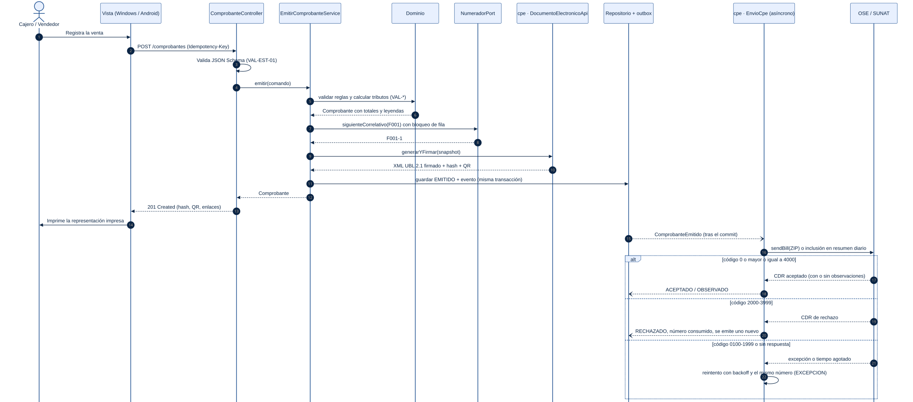

# 6. Entregable 2: arquitectura MVC con visión hexagonal

**Idea central: MVC por fuera, hexágono por dentro.** El sistema nace como un **monolito modular** que cumple MVC al pie de la letra:

- **Vista:** pantallas nativas y representaciones JSON, PDF y XML.
- **Controlador:** controladores Spring Web MVC.
- **Modelo:** el núcleo de la aplicación.

La diferencia es que el Modelo ya está organizado con **puertos y adaptadores**. El paso a hexagonal o Clean Architecture es reubicar código, no reescribirlo, y el paso a microservicios consiste en cambiar adaptadores (en proceso → red), sin tocar el dominio.

## 6.1 Atributos de calidad y restricciones (drivers)

**Tabla 6.1.** *Requisitos no funcionales*

| ID | Atributo | Requisito medible |
|---|---|---|
| RNF-01 | Disponibilidad de la venta | La emisión no depende de internet ni de OSE/SUNAT (cola + reintentos). Objetivo: 99,5 % en horario comercial |
| RNF-02 | Rendimiento | `POST /comprobantes` p95 < 1,5 s con 20 puntos de emisión concurrentes; `POST /comprobantes/calculos` p95 < 300 ms |
| RNF-03 | Exactitud | 0 diferencias entre el importe cobrado y el XML; regresión con los 4 XML de referencia |
| RNF-04 | Integridad | XML firmado; hash (`DigestValue`) verificable; documentos emitidos inmutables |
| RNF-05 | Conservación | XML, CDR y PDF por al menos 5 años; respaldo diario y prueba de restauración mensual |
| RNF-06 | Trazabilidad | `correlationId` de extremo a extremo, auditoría y linaje de migración |
| RNF-07 | Seguridad | TLS 1.2 o superior, JWT con roles, dispositivos registrados, secretos cifrados, certificado solo en el servidor |
| RNF-08 | Portabilidad | Windows 10/11 x64 (MSI) y Android 8.0 o superior, API 26 (APK) |
| RNF-09 | Evolución | Reglas de arquitectura verificadas en CI; contratos con versión SemVer; cambios normativos como datos |
| RNF-10 | Usabilidad | Boleta en 3 pasos como máximo; lector de código de barras; errores en español que citan la regla |
| RNF-11 | Observabilidad | Métricas de cola (pendientes y antigüedad), rechazos y salud en `GET /sistema/salud` |
| RNF-12 | Escalabilidad | Fase 1: 50 000 comprobantes al mes sin cambios de arquitectura; fase 3: escala por servicio |

Restricciones del enunciado: monolito MVC limpio (REQ-10); ejecución nativa en Windows y Android con MSI y APK (REQ-11); cumplimiento SUNAT (REQ-09).

## 6.2 Vistas de contexto y de contenedores (C4)

**Figura 6.1.** *Diagrama de contexto (C4, nivel 1)*



**Figura 6.2.** *Diagrama de contenedores (C4, nivel 2)*



*Nota.* Elaboración propia con la notación C4 (Brown, 2018).

## 6.3 MVC con núcleo hexagonal

**Figura 6.3.** *Arquitectura MVC del monolito con su Modelo organizado en puertos y adaptadores*



**Tabla 6.2.** *Correspondencia entre MVC, hexagonal y paquetes*

| MVC | Hexagonal / Clean | Paquete Java (por módulo) | Ejemplo en `facturacion` | Depende de |
|---|---|---|---|---|
| Vista | Fuera del hexágono (UI) | `clientes/` (Compose) y DTO generados | Pantalla "Nueva venta"; `ComprobanteDto` | API REST |
| Controlador | Adaptador primario | `..web` | `ComprobanteController implements ComprobantesApi` (interfaz generada del OpenAPI) | Puertos de entrada |
| Modelo: aplicación | Puertos de entrada + casos de uso | `..aplicacion.puerto.entrada`, `..aplicacion.servicio` | `EmitirComprobanteUseCase`, `EmitirComprobanteService` | Dominio y puertos de salida |
| Modelo: dominio | Entidades (Clean) / núcleo | `..dominio` | `Comprobante`, `Serie`, `MotorTributario` | Nada (Java puro) |
| Modelo: puertos de salida | Puertos secundarios | `..aplicacion.puerto.salida` | `ComprobanteRepository`, `NumeradorPort`, `DocumentoElectronicoPort` | Dominio |
| (infraestructura) | Adaptadores secundarios | `..infraestructura.*` | `ComprobanteJpaAdapter`, `DocumentoElectronicoCpeAdapter` | Puertos de salida |

**¿Por qué así?** Un MVC "clásico" deja que el controlador hable con repositorios JPA y que las entidades JPA sean el modelo. Eso acopla el dominio a la base de datos y hace imposible extraer servicios sin reescribir. Aquí la regla de dependencia apunta siempre **hacia el dominio**: el controlador solo conoce casos de uso, y la infraestructura implementa interfaces del núcleo.

## 6.4 Vista hexagonal y catálogo de puertos

**Figura 6.4.** *Vista hexagonal: adaptadores primarios, núcleo y adaptadores secundarios*



*Nota.* Las flechas muestran el flujo de llamadas; las dependencias de código apuntan siempre hacia el núcleo (inversión de dependencias).

**Tabla 6.3.** *Puertos de salida y sus adaptadores*

| Puerto (interfaz del núcleo) | Módulo | Adaptador fase 1 (en proceso) | Adaptador fase 3 |
|---|---|---|---|
| `ComprobanteRepository` | facturacion | JPA sobre el esquema `facturacion` | Igual (base de datos propia del servicio) |
| `NumeradorPort` | facturacion | `UPDATE ... RETURNING` con bloqueo de fila | Igual, dentro de facturacion-service |
| `DocumentoElectronicoPort` | facturacion | Llamada en proceso a `cpe.api.DocumentoElectronicoApi` | Cliente HTTP o gRPC hacia cpe-service |
| `ParametrosTributariosPort` | facturacion, catalogo | Llamada a `tributacion` | Caché local con suscripción a cambios |
| `ConsultaContribuyentePort` | terceros | Padrón reducido del RUC (descarga diaria) + servicio externo de respaldo | Igual |
| `GeneradorUblPort` | cpe | Serializador JAXB (clases xjc del XSD UBL 2.1) | Igual, dentro de cpe-service |
| `FirmadorXmlPort` | cpe | XMLDSig del JDK (JSR 105) con `.pfx` cifrado | HSM o servicio de firma |
| `CanalEnvioCpePort` | cpe | Cliente SOAP `billService` (OSE o SUNAT) | Igual, dentro de cpe-service |
| `AlmacenDocumentosPort` | cpe | Sistema de archivos | Almacenamiento de objetos |
| `RepresentacionImpresaPort` | cpe | PDF A4 / ticket con QR | Igual |
| `PublicadorEventosPort` | todos | Bus interno + tabla outbox | Broker AMQP (mismo AsyncAPI) |
| `LectorLegadoPort` | migracion | CSV / XLSX | Access, DBF, JDBC |
| `NotificadorPort` | notificaciones | SMTP y enlace de WhatsApp | Proveedor de mensajería |

Los puertos de entrada (casos de uso) están en el OpenAPI: cada operación declara su `x-puerto-entrada`. Ejemplo: `POST /comprobantes` → `EmitirComprobanteUseCase`.

## 6.5 Módulos y reglas de dependencia

**Figura 6.5.** *Módulos (contextos delimitados) y sus dependencias permitidas*



*Nota.* Línea continua: dependencia síncrona a la API pública de otro módulo. Línea punteada: eventos a través del lenguaje publicado (`contratos`). El grafo no tiene ciclos.

Las reglas se **verifican en cada compilación**; no son una recomendación:

```java
// Reglas de arquitectura (ArchUnit + Spring Modulith). Si alguna falla, la compilación en CI falla.
@AnalyzeClasses(packages = "pe.abc.comercial")
class ReglasDeArquitecturaTest {

    @ArchTest
    static final ArchRule dominioSinFrameworks = noClasses()
            .that().resideInAPackage("..dominio..")
            .should().dependOnClassesThat().resideInAnyPackage(
                    "org.springframework..", "jakarta.persistence..", "..web..", "..infraestructura..");

    @ArchTest
    static final ArchRule capas = layeredArchitecture().consideringOnlyDependenciesInLayers()
            .layer("Controlador").definedBy("..web..")
            .layer("Aplicacion").definedBy("..aplicacion..")
            .layer("Dominio").definedBy("..dominio..")
            .layer("Infraestructura").definedBy("..infraestructura..")
            .whereLayer("Controlador").mayNotBeAccessedByAnyLayer()
            .whereLayer("Aplicacion").mayOnlyBeAccessedByLayers("Controlador", "Infraestructura")
            .whereLayer("Dominio").mayOnlyBeAccessedByLayers("Aplicacion", "Infraestructura")
            .whereLayer("Infraestructura").mayNotBeAccessedByAnyLayer();
}

class ModulosTest {
    @Test
    void modulosSinCiclosNiAccesoAInternos() {
        ApplicationModules.of(AbcComercialApplication.class).verify();
    }
}
```

## 6.6 Estructura del código

```text
servidor/                                   (Java 21, Spring Boot 3, Spring Modulith)
└── src/main/java/pe/abc/comercial
    ├── facturacion
    │   ├── web/                    C  ComprobanteController implements ComprobantesApi (generada)
    │   ├── aplicacion/
    │   │   ├── puerto/entrada/        EmitirComprobanteUseCase, CalcularComprobanteUseCase ...
    │   │   ├── puerto/salida/         ComprobanteRepository, NumeradorPort, DocumentoElectronicoPort
    │   │   └── servicio/              EmitirComprobanteService (@Transactional)
    │   ├── dominio/                M  Comprobante, LineaComprobante, Serie, objetos de valor
    │   └── infraestructura/           persistencia (JPA), cpe (adaptador a DocumentoElectronicoApi)
    ├── cpe/                           api/, ..., infraestructura/{ubl, firma, sunat, pdf}
    ├── tributacion/ terceros/ catalogo/ inventario/ registros/ migracion/
    ├── configuracion/ seguridad/ notificaciones/
    └── contratos/                     eventos generados desde specs/asyncapi y specs/schemas
clientes/                                   (Kotlin, Compose Multiplatform)
├── compartido/                     V  SDK generado del OpenAPI (Ktor), ViewModels, caché SQLDelight
├── escritorio/                        Windows → ./gradlew packageMsi
└── android/                           Android → ./gradlew assembleRelease (APK)
specs/                                      contratos (fuente de verdad, Spec-First)
```

Generación desde los contratos (Spec-First): `openapi-generator` con `spring` + `interfaceOnly=true` produce las interfaces del servidor, y con `kotlin` + `multiplatform` produce el SDK de los clientes. Si el código no cumple el contrato, no compila.

## 6.7 Vista dinámica: emisión de un comprobante

**Figura 6.6.** *Secuencia de emisión: síncrona hasta la firma, asíncrona hacia OSE/SUNAT*



El trabajo crítico (validar, calcular, numerar, generar y firmar) ocurre en una sola transacción local. Por eso la venta no depende de internet. El envío ocurre después del *commit*, mediante el evento guardado en la tabla outbox (ADR-05).

## 6.8 Despliegue y distribución multiplataforma

**Figura 6.7.** *Despliegue on-premise con clientes MSI y APK*



**Tabla 6.4.** *Especificación de empaquetado y ejecución nativa*

| Aspecto | Windows (escritorio) | Android |
|---|---|---|
| Tecnología de vista | Compose Multiplatform para Desktop: aplicación de escritorio con su propio *runtime* (jlink); no usa navegador | Compose para Android: aplicación nativa (ART) |
| Paquete | **MSI** con `./gradlew packageMsi` (jpackage + WiX) | **APK** firmado (esquemas v2 y v3) con `./gradlew assembleRelease` |
| Instalación | `msiexec /i ABC-Comercial-1.0.0.msi /qn SERVIDOR_URL=https://servidor-abc:8443` (silenciosa, por GPO o Intune); acceso directo; desinstalación desde Windows | Instalación directa o por MDM; `minSdk` 26 (Android 8.0) |
| Actualización | `MajorUpgrade` con `UpgradeCode` fijo; el cliente consulta `GET /sistema/version-cliente` y bloquea si está por debajo de la versión mínima (426) | Misma consulta; descarga del APK con verificación SHA-256 |
| Dispositivos | Ticketera USB (ESC/POS o *spooler*), lector de código de barras HID | Cámara para leer códigos, impresora Bluetooth ESC/POS |
| Firma del paquete | Authenticode (recomendado) | Keystore de *release* guardado fuera del repositorio |
| Servidor | `ABC-Comercial-Servidor-1.0.0.msi`: servicio de Windows con JRE embebido, configuración en `C:\ProgramData\ABC\`; requiere PostgreSQL 16 | — |
| Sin conexión | Caché de catálogos y precios; si el servidor no responde, avisa y no emite (el certificado vive en el servidor) | Igual; la preventa sin conexión llega en la fase 2 (CU-31) |

## 6.9 Evolución: de MVC a hexagonal y a microservicios

**Figura 6.8.** *Ruta de evolución arquitectónica*



1. **Fase 1, monolito modular MVC (esta especificación).** Un desplegable, módulos con puertos, eventos internos con outbox y un esquema de base de datos por módulo.
2. **Fase 2, hexagonal estricta.** Cada módulo se divide en módulos de compilación (`dominio`, `aplicacion`, `adaptadores`). Como las reglas ArchUnit ya garantizan esas fronteras, es una mudanza mecánica.
3. **Fase 3, microservicios con el patrón estrangulador.** Primero se extrae **cpe-service**: es intensivo en I/O, necesita reintentos y alta disponibilidad, y su contrato ya es asíncrono. Luego `inventario` y `catalogo`. El API Gateway publica el **mismo OpenAPI** `/api/v1` y el broker transporta los **mismos mensajes** del AsyncAPI. Los clientes no se enteran del cambio.

Criterios para extraer un módulo: carga o escalado distinto, frecuencia de cambio propia, equipo dueño y contrato estable. Lo que **no** se extrae temprano: `facturacion` y `tributacion` comparten la transacción de emisión, y separarlos antes de tiempo introduciría consistencia eventual en la numeración.

## 6.10 Decisiones de arquitectura (ADR)

**Tabla 6.5.** *Registro de decisiones*

| ADR | Decisión | Alternativas descartadas | Consecuencia |
|---|---|---|---|
| ADR-01 | Spec-First: OpenAPI 3.1, JSON Schema 2020-12 y AsyncAPI 3.0 como fuente de verdad; generación de código y pruebas de contrato | "Code-first" con anotaciones | Contratos revisables antes de programar; los cambios se discuten sobre los specs |
| ADR-02 | Monolito modular MVC con núcleo hexagonal | Microservicios desde el día 1; MVC clásico acoplado a JPA | Simplicidad operativa hoy; extracción barata mañana |
| ADR-03 | Servidor: Java 21 + Spring Boot 3 (Web MVC, Modulith) + PostgreSQL 16. Clientes: Kotlin + Compose Multiplatform (MSI y APK) | .NET (ASP.NET Core MVC + MAUI + WiX), viable pero MSIX por defecto y sin afinidad con el equipo; Flutter, nativo pero sin ecosistema XMLDSig ni lenguaje común con el servidor; Electron + Capacitor, no nativo (WebView) | Ecosistema JVM común; XMLDSig del JDK; `packageMsi` integrado |
| ADR-04 | Firma y envío centralizados en el servidor | Firmar en cada dispositivo | El certificado nunca sale del servidor (RSK-04) |
| ADR-05 | Emisión síncrona (numerar y firmar) + envío asíncrono con outbox, reintentos y alertas | Esperar el CDR para terminar la venta | La venta no depende de SUNAT/OSE (RNF-01) |
| ADR-06 | Canal intercambiable OSE / SUNAT, beta / producción | Acoplarse a un proveedor | Cambiar de OSE es configuración |
| ADR-07 | Motor tributario único en el servidor; `BigDecimal` HALF_UP; endpoint de cálculo para las vistas | Calcular en cada cliente | Sin diferencias de céntimos (RSK-06) |
| ADR-08 | Catálogos, parámetros, tasas ISC y reglas como datos versionados con vigencia | Enums y constantes en el código | Los cambios normativos no requieren desplegar (RSK-01) |
| ADR-09 | Migración con staging, reglas declarativas versionadas y linaje inmutable | Copia directa del legado a las tablas nuevas | Trazabilidad completa y reproceso seguro (REQ-08) |
| ADR-10 | Una serie por punto de emisión + `Idempotency-Key` | Una serie compartida | Sin contención ni duplicados (RSK-05) |
| ADR-11 | Generación de XML UBL con clases JAXB (xjc), serialización con Marshaller y validación contra esquema XSD | Plantillas de texto (FreeMarker, Thymeleaf); manipulación DOM directa | Tipado estricto, orden de elementos garantizado (xsd:sequence) y validación previa a la firma |

**Tabla 6.6.** *Evaluación de la tecnología de los clientes (ADR-03)*

| Criterio | Compose Multiplatform (Kotlin) | .NET MAUI | Flutter | Electron + Capacitor |
|---|---|---|---|---|
| Ejecución nativa en Windows y Android | Sí (Android nativo; escritorio con *runtime* embebido) | Sí | Sí (AOT) | No (WebView) |
| MSI y APK sin herramientas de terceros | Sí (`packageMsi`, APK) | Parcial (MSIX por defecto; MSI con WiX) | Parcial (MSI con WiX) | Sí (electron-builder; APK) |
| Lenguaje y SDK comunes con el servidor | Sí (JVM; SDK generado del OpenAPI) | No (C# frente a Java) | No (Dart) | Parcial (TypeScript) |
| Acceso a impresora ESC/POS y lector | Sí | Sí | Sí (plugins) | Parcial |
| Conocimiento previo del equipo | Alto (Java/Spring) | Bajo | Bajo | Medio |

## 6.11 Seguridad

- **Transporte:** TLS 1.2 o superior entre clientes y servidor (certificado interno de la empresa); SOAP sobre HTTPS hacia OSE/SUNAT.
- **Identidad:** usuarios con contraseña (hash Argon2/bcrypt) y dispositivo registrado; JWT de corta duración con roles (`ADMINISTRADOR`, `CAJERO`, `VENDEDOR`, `ALMACENERO`, `CONTADOR`, `GERENTE`) y token de refresco.
- **Secretos:** la clave del `.pfx` y la clave SOL u OSE se guardan cifradas (DPAPI o almacén de llaves); nunca en el código ni en los clientes.
- **Base de datos:** un usuario por esquema con mínimo privilegio; auditoría de solo inserción; respaldos cifrados.
- **Datos personales (Ley 29733):** solo los datos que exige SUNAT; acceso registrado en la auditoría.
