# 9. Especificación de la migración del legado

## 9.1 Diagnóstico del sistema actual

El "software operativo básico" registra fichas con cinco campos: `fecha`, `ingreso`, `salida`, `producto` y `nro_documento`. Comparadas con el Formato 12.1 de la RS 234-2006, esas fichas son un **kárdex informal**. Les falta lo que hace formal al registro:

| Problema esperado | Ejemplo (`specs/ejemplos/json/06-ficha-legado.json`) | Consecuencia |
|---|---|---|
| Fechas en formatos mezclados o inválidas | `03/09/2025`, `2025-09-04`, `05-09-25`, `31/09/2025` | MIG-01 normaliza; la fecha inválida queda OBSERVADA |
| Ingreso y salida en la misma ficha | `ingreso: 10, salida: 10` | MIG-02 la observa (posible doble registro) |
| Producto en texto libre con variantes | `LECHE EVAP. X 48 LAT`, `Leche evaporada caja 48` | MIG-03 normaliza y compara con el maestro |
| Documento informal | `FACT 001-4587`, `B001-0000231`, `GUIA 0002-781`, `s/n` | MIG-04 clasifica según la Tabla 10 y conserva el texto original |
| Sin unidad, tipo de existencia ni tipo de operación | — | MIG-05 y MIG-07 los infieren o asignan por defecto y lo marcan como supuesto |

## 9.2 Principios

1. **Nada se pierde:** cada ficha se copia íntegra a *staging* con su SHA-256 antes de transformarla.
2. **Nada se inventa en silencio:** cada inferencia queda marcada (`MIGRADO_CON_SUPUESTOS`) y cada duda pasa a revisión humana (`OBSERVADO`).
3. **Todo es reproducible:** las reglas están en un archivo versionado (`specs/migracion/reglas-mapeo-legado.yaml`) y cada lote guarda la versión usada.
4. **Todo es rastreable en ambos sentidos:** el linaje es inmutable (ficha → movimiento y movimiento → ficha).
5. **Se respetan los módulos:** `migracion` escribe solo mediante las API de `catalogo` e `inventario`, nunca directo en sus tablas.

## 9.3 Proceso

**Figura 9.1.** *Flujo de migración con staging, revisión, conciliación y linaje*

Estados del lote: `CARGADO → PERFILADO → TRANSFORMADO → EN_REVISION → CONFIRMADO`. `REVERTIDO` solo es posible antes de la puesta en producción (MIG-12).

## 9.4 Reglas de mapeo

**Tabla 9.1.** *Reglas de migración (detalle en `reglas-mapeo-legado.yaml`)*

| ID | Regla | Resultado |
|---|---|---|
| MIG-01 | La fecha acepta `dd/MM/yyyy`, `yyyy-MM-dd`, `dd-MM-yy` y `dd.MM.yyyy`; los años de dos dígitos se leen como 20aa | Inválida → OBSERVADO; posterior al corte → RECHAZADO |
| MIG-02 | Ingreso > 0 → entrada; salida > 0 → salida; ambos > 0 → OBSERVADO; ambos 0 → RECHAZADO | Cantidades del Formato 12.1 |
| MIG-03 | El producto se normaliza (mayúsculas, sin tildes, sinónimos) y se compara con el maestro: exacto → MIGRADO; similitud Jaro-Winkler ≥ 0,92 → propuesta con supuestos; menor → OBSERVADO | `Producto.codigo` |
| MIG-04 | El `nro_documento` se clasifica por patrones P1 a P6 (Tabla 9.2) | `DocumentoSoporte` (Tabla 10, serie, número y texto original) |
| MIG-05 | El tipo de operación (Tabla 12) se infiere del sentido y del documento (compra 02, venta 01, merma 13, devolución 05/06); sin documento → 99 OBSERVADO | `MovimientoInventario.tipoOperacion` |
| MIG-06 | El mismo hash dentro del lote se RECHAZA (reproceso idempotente); la misma fecha, producto, cantidad y documento se OBSERVA | Sin duplicados |
| MIG-07 | Valores por defecto: tipo de existencia 01 (Mercadería) y unidad 07 (Unidades) | Supuesto visible |
| MIG-08 | Saldo inicial al corte por producto (Tabla 12 = 16); la historia previa queda solo para consulta | El Formato 12.1 oficial empieza al día siguiente del corte |
| MIG-09 | Confirmar exige 0 observados, conciliación conforme y aprobación de gerente y contador | `POST .../confirmacion`; si no, 409 |
| MIG-10 | Controles de conciliación CTL-01 a CTL-05 (sección 9.6) | `GET .../conciliacion` |
| MIG-11 | Linaje de solo inserción por cada registro migrado | `GET /migraciones/linaje` |
| MIG-12 | No se carga dos veces el mismo archivo; un lote confirmado no se edita; la reversión deja linaje | Integridad |

**Tabla 9.2.** *Patrones para el `nro_documento` (MIG-04)*

| Patrón | Ejemplo | Tabla 10 | Serie / número |
|---|---|---|---|
| P1 `^[FB][A-Z0-9]{3}-?0*\d{1,8}$` | `B001-0000231` | 03 (B) / 01 (F) | `B001` / `231` |
| P2 `^(FACT(URA)?\|FAC\|F)\.?\s*\d{1,4}-\d{1,8}$` | `FACT 001-4587` | 01 | `0001` / `4587` |
| P3 `^(BOL(ETA)?\|BV\|B)\.?\s*\d{1,4}-\d{1,8}$` | `BOL 2-15` | 03 | `0002` / `15` |
| P4 `^(GR\|GUIA\|G/R)\.?\s*[A-Z0-9]{1,4}-\d{1,8}$` | `GUIA 0002-781` | 09 | `0002` / `781` |
| P5 `^(NC\|N/C)\.?\s*[A-Z0-9]{1,4}-\d{1,8}$` | `NC 001-12` | 07 | `001` / `12` |
| P6 vacío, `S/N`, `-` | `s/n` | 00 (interno) | número `SN-{idLegado}` |
| Sin patrón | `pedido Juan` | 00 | Texto original → OBSERVADO |

## 9.5 Ejemplo trabajado

**Tabla 9.3.** *Las cuatro fichas de ejemplo después de aplicar las reglas*

| Ficha legada | Fecha | Sentido y cantidad | Producto (maestro) | Documento (Tabla 10) | Tabla 12 | Estado |
|---|---|---|---|---|---|---|
| `#145` `03/09/2025`, ingreso 120, `LECHE EVAP. X 48 LAT`, `FACT 001-4587` | 2025-09-03 | Entrada 120 | LEC-EVA-48 (sinónimos + similitud) | 01 · 0001-4587 (P2) | 02 Compra | MIGRADO_CON_SUPUESTOS |
| `#146` `2025-09-04`, salida 15, `Leche evaporada caja 48`, `B001-0000231` | 2025-09-04 | Salida 15 | LEC-EVA-48 | 03 · B001-231 (P1) | 01 Venta | MIGRADO_CON_SUPUESTOS |
| `#147` `05-09-25`, salida 3, `ACEITE VEG CJ12`, `s/n` | 2025-09-05 | Salida 3 | ACE-VEG-12 | 00 · SN-… (P6) | 99 (¿merma o venta?) | OBSERVADO |
| `#148` `31/09/2025`, ingreso 10 y salida 10, `FIDEOS SPAGUETTI CJ 20`, `GUIA 0002-781` | inválida | Ambos > 0 | FID-SPA-20 | 09 · 0002-781 (P4) | — | OBSERVADO |

Las fichas `#147` y `#148` van a la cola de revisión (CU-18). El contador las resuelve con `PATCH /migraciones/registros/{id}` y una justificación obligatoria que queda en el linaje.

## 9.6 Conciliación y criterio de aceptación

| Control | Verifica | Criterio |
|---|---|---|
| CTL-01 | Total = migrados + con supuestos + rechazados | Observados = 0 |
| CTL-02 | Por producto: Σ ingresos − Σ salidas del legado = saldo inicial creado | Diferencia = 0 |
| CTL-03 | Suma de control de cantidades de entrada y salida, origen frente a destino | Diferencia = 0 |
| CTL-04 | SHA-256 del archivo frente al registrado en la carga | Iguales |
| CTL-05 | Muestra aleatoria del 5 % revisada por el contador | Firmada |

## 9.7 Plan de corte

1. **Limpieza previa:** se crea el maestro de productos con códigos (CU-12 y CU-13) y el diccionario de sinónimos.
2. **Ensayo:** carga completa en un ambiente de pruebas; se mide el porcentaje de observados y se ajustan las reglas (nueva versión).
3. **Corrida en paralelo** (1 a 2 semanas): el legado y el sistema nuevo operan a la vez y se comparan los saldos diarios.
4. **Corte:** el legado pasa a solo lectura; se hace la exportación final, se carga el lote definitivo, se concilia y se obtiene la aprobación del gerente y del contador.
5. **Arranque:** los saldos iniciales (Tabla 12 = 16) abren el Formato 12.1 oficial desde el día siguiente.
6. **Archivo:** el legado y su exportación se conservan con su hash durante el plazo legal.

*Plan de reversa:* si la conciliación no es conforme, el legado sigue operando y el lote se REVIERTE con linaje. No hay pérdida de datos porque *staging* conserva todo.
