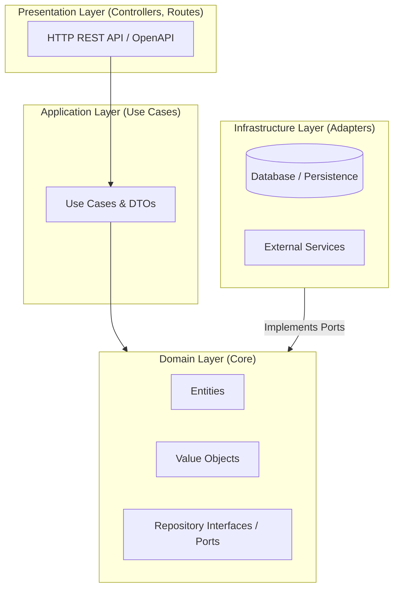

# 📐 Software Architecture Specification

## 1. Architectural Style: Clean / Hexagonal (Ports & Adapters)

This project follows Clean Architecture principles, ensuring that business rules are independent of frameworks, databases, and user interfaces.

## 2. Dependency Rule
Dependencies only point inward:
- **Presentation** depends on **Application**.
- **Application** depends on **Domain**.
- **Infrastructure** depends on **Domain** (Dependency Inversion).
- **Domain** depends on **nothing**.

## 3. Spec-First Alignment
Every component in the architecture maps directly to an approved specification:
- Endpoints in Presentation map to `specs/api/openapi.yaml`.
- Use Cases in Application map to `specs/requirements/functional-requirements.md`.
- Entities in Domain map to `specs/data-models/schemas/`.
- Architectural shifts are recorded in `specs/adrs/`.
