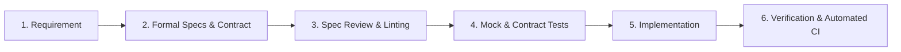

# 📋 Specifications (Single Source of Truth)

In **Spec-Driven Development (SDD)** with a **Spec-First** approach, specifications are written, reviewed, and approved **before** any production code is created.

The specifications in this directory are the single source of truth (SSOT) for the entire project.

---

## 📂 Directory Structure

```text
specs/
├── requirements/     # High-level PRDs, Functional & Non-Functional Specifications
├── adrs/             # Architectural Decision Records (ADRs)
├── api/              # OpenAPI contracts, GraphQL schemas, gRPC protobufs
├── acceptance/       # BDD / Gherkin feature files executable as test criteria
├── data-models/      # JSON Schemas, ERDs, Domain entity specifications
└── templates/        # Reusable templates for new features and ADRs
```

---

## 🔄 The Spec-First Workflow



1. **Specify**: Define business requirements, acceptance criteria, and API contracts.
2. **Review & Lint**: Review the spec against domain models and run linters (e.g., Spectral for OpenAPI).
3. **Mock & Test-First**: Generate API mocks from the contract so clients and frontends can develop in parallel. Write contract and acceptance tests based on the spec.
4. **Implement**: Code the solution in `src/` to satisfy the tests and spec contracts.
5. **Verify**: Ensure 100% compliance with automated contract and acceptance tests.

---

## 📜 Golden Rules of Spec-Driven Development

1. **No Code Without a Spec**: No feature or endpoint is developed without an approved specification or contract.
2. **Spec Updates First**: Any bug fix or scope change that changes behavior must update the specification first.
3. **Automated Enforcement**: Specs are not passive documents; they drive mocks, validators, and contract test suites.
