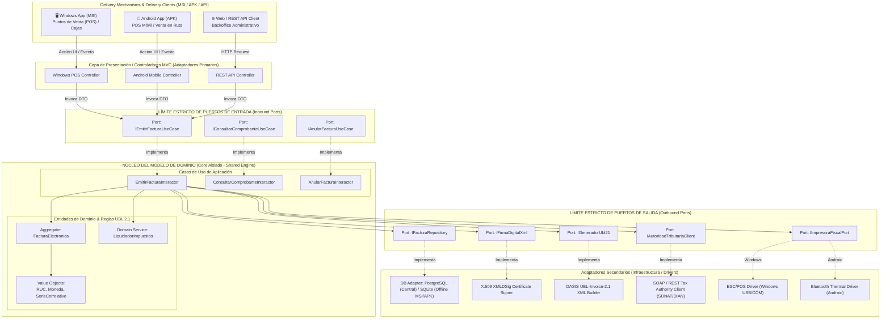

# 🏛️ ADR-0001: Arquitectura Base MVC con Puertos y Adaptadores para Facturación Electrónica Multiplataforma (MSI y APK) y Estrategia de Migración hacia Arquitectura Hexagonal y Microservicios

* **Estado:** Aprobado (Accepted)
* **Fecha:** 2026-10-22
* **Organización:** ABC Software Corp
* **Proyecto:** Sistema de Facturación Electrónica UBL 2.1
* **Autor(es):** Arquitecto de Software Principal
* **Decisores:** Comité de Arquitectura, Dirección de Ingeniería, Gerencia de Producto

---

## 1. Contexto de Negocio y Planteamiento del Problema

ABC Software Corp se encuentra en el proceso de desarrollo de su nueva plataforma estratégica de **Facturación Electrónica**, orientada a cumplir con la estricta normativa fiscal de comprobantes de pago electrónicos bajo el estándar internacional **UBL 2.1 (Universal Business Language)**.

### Restricciones y Desafíos Clave del Negocio:
1. **Velocidad de Salida al Mercado (Time-to-Market):** El equipo de desarrollo cuenta con amplia experiencia y madurez en el patrón arquitectónico **MVC (Modelo-Vista-Controlador)**. Iniciar directamente con una topología de microservicios distribuidos acarrearía una sobrecarga operacional excesiva, complejidad de red, latencia innecesaria y riesgos de cronograma.
2. **Requerimiento Corporativo Multiplataforma (Gerencia):**
   - **Instalador de Escritorio MSI (.msi) para Windows:** Requerido para estaciones de punto de venta (POS) tradicionales, cajas en supermercados/tiendas físicas, impresoras térmicas ESC/POS (USB/Serial) y conectividad a base de datos local o LAN.
   - **Paquete Móvil APK (.apk) para Android:** Requerido para fuerza de ventas en ruta, terminales POS móviles inalámbricos (SmartPOS) y emisión de comprobantes en campo con soporte para impresoras Bluetooth y pantallas táctiles.
3. **Evolutividad y Escalabilidad Futura:** Aunque el sistema debe iniciar como un **monolito limpio y modular**, está prohibido acoplar las reglas fiscales y de cálculo a la base de datos o al framework de interfaz. El diseño debe permitir que, cuando el volumen transaccional crezca (millones de facturas/mes), los módulos críticos puedan evolucionar de forma natural hacia una **Arquitectura Hexagonal pura** y posteriormente desacoplarse en **Microservicios independientes** sin reescribir la lógica de dominio.

---

## 2. Decisión Arquitectónica

Se adopta una **Arquitectura Monolítica Modular Limpia basada en MVC Desacoplado con Puertos y Adaptadores (Hexagonal-Ready)**.

Bajo este modelo:
1. **El Controlador (Controller) es un Adaptador Primario Delgado:** No contiene lógica de negocio ni manipula directamente consultas SQL. Únicamente se encarga de recibir las intenciones de usuario (desde la UI de Windows, la UI de Android o la API HTTP), sanitizar la entrada y delegar la ejecución a los Casos de Uso del Modelo.
2. **El Modelo (Model) está estrictamente dividido en dos capas desvinculadas de la infraestructura:**
   - **Capa de Dominio Puro (Domain Core):** Contiene las entidades fiscales UBL 2.1 (`Factura`, `DetalleFactura`, `Impuesto`), Value Objects inmutables (`RUC`, `Moneda`, `SerieNumero`), y las políticas fiscales puras (cálculo de base imponible, IGV/IVA, exoneraciones, descuentos). No tiene dependencias de librerías externas ni de frameworks de base de datos.
   - **Puertos de Entrada y Salida (Ports):** Interfaces que aíslan al núcleo del mundo exterior.
     - *Puertos de Entrada (Inbound Ports / Use Cases):* `EmitirFacturaUseCase`, `ConsultarEstadoComprobanteUseCase`, `AnularFacturaUseCase`.
     - *Puertos de Salida (Outbound Ports / Interfaces):* `FacturaRepositoryPort`, `FirmaDigitalPort`, `GeneradorXmlUblPort`, `ServicioTributarioPort`, `ImpresoraTermicaPort`.
3. **La Vista (View) y los Adaptadores Secundarios son intercambiables:**
   - Para Windows (.msi), la vista se integra con la UI nativa/desktop y un adaptador de persistencia local (SQLite o PostgreSQL).
   - Para Android (.apk), la vista se integra con la interfaz móvil táctil y un adaptador de persistencia local (SQLite/Room) con capacidades de sincronización offline.

---

## 3. Diagrama Arquitectónico (Mermaid.js)



---

## 4. Estrategia de Empaquetamiento Multiplataforma: MSI (Windows) y APK (Android)

Para soportar los requisitos de despliegue de Gerencia sin duplicar código ni fragmentar la lógica de negocio, se establece la siguiente estrategia de arquitectura:

### 4.1. Núcleo Compartido Aislado (*Shared Core Engine*)
- El núcleo de dominio (cálculo tributario, validaciones UBL 2.1, generación de Hash SHA-256, estructura de datos y orquestación de casos de uso) se compila como una **librería de código compartido agnóstica a la plataforma** (e.g., .NET Standard / Kotlin Multiplatform / C++ Core embebible / TypeScript en runtime desacoplado).
- El núcleo **no contiene dependencias de Windows ni de Android**.

### 4.2. Empaquetado para Windows (.MSI)
- **Tecnología de Empaque:** WiX Toolset / Inno Setup / MSI Wrapper que genera un instalador estándar `.msi`.
- **Modo de Operación:**
  - Puede operar en modo **Conectado a Red Local (LAN)** comunicándose con la base de datos central PostgreSQL.
  - Cuenta con un adaptador local **SQLite** para contingencia offline.
- **Hardware Específico:** Driver adaptador para impresoras de corte térmico POS mediante puertos físicos USB, COM (RS-232) o Ethernet TCP/IP.
- **Firma Digital:** Acceso a almacén de certificados de Windows (CryptoAPI / CNG) o certificados en archivo `.pfx` / `.p12`.

### 4.3. Empaquetado para Android (.APK)
- **Tecnología de Empaque:** Gradle Android Build System generando un `.apk` firmado y alineado con zipalign.
- **Modo Offline-First (Venta en Ruta):**
  - El APK almacena los comprobantes emitidos en una base de datos local SQLite (Room/SQLDelight).
  - Cada comprobante se genera y sella criptográficamente de manera local generando el Código QR y Hash de contingencia para ser impreso de inmediato ante el cliente.
  - Un servicio en segundo plano (*Background Sync Worker*) detecta cuando el dispositivo recupera señal 4G/5G/Wi-Fi y despacha en lotes los comprobantes pendientes hacia la autoridad tributaria mediante el puerto `IAutoridadTributariaClient`.
- **Hardware Específico:** Adaptador de impresión inalámbrico mediante Bluetooth SPP (Serial Port Profile) para impresoras portátiles de 58mm y 80mm.

---

## 5. Hoja de Ruta de Evolución: De Monolito a Microservicios

El valor de definir estrictamente los puertos y adaptadores desde el día uno es que la migración futura no requiere rehacer el sistema; consiste únicamente en mover los límites físicos de despliegue:

```mermaid
journey
    title Ruta de Transición Arquitectónica
    section Fase 1: Monolito MVC Limpio
      Controladores delgados: 5: Arquitecto, Dev
      Núcleo UBL unificado: 5: Arquitecto, Dev
      Despliegue MSI y APK: 5: Operaciones
    section Fase 2: Hexagonal Puro
      Desacoplamiento total de UI: 4: Dev
      Inyección de dependencias estricta: 5: Dev
      Tests de contrato automatizados: 5: QA
    section Fase 3: Microservicios
      Servicio de Emisión (Core): 4: Dev, DevOps
      Servicio de Firma Criptográfica (CPU Intensive): 5: DevOps
      Worker Asíncrono de Envío Fiscal (RabbitMQ/Kafka): 5: DevOps
```

### Fase 1: Monolito Modular MVC con Puertos (Estado Inicial)
- Una única solución de código con fronteras lógicas estrictas.
- Invocaciones directas en memoria a través de las interfaces de los Puertos.
- Ideal para validar el producto, certificar ante la entidad tributaria y cumplir con las entregas de MSI y APK.

### Fase 2: Arquitectura Hexagonal Desacoplada (Transición Media)
- Separación formal de librerías y contratos.
- Pruebas automatizadas de contrato contra los puertos de salida mediante mocks sin tocar la base de datos ni los servidores del fisco.
- Preparación de eventos de dominio (`FacturaEmitidaEvent`, `FacturaRechazadaEvent`).

### Fase 3: Microservicios Distribuidos (Alta Escala)
Cuando el volumen de transacciones justifique la distribución:
1. **Billing Core Service (Microservicio de Emisión):** Expone API REST / gRPC para registrar ventas y validar reglas tributarias.
2. **UBL & XMLDSig Cryptographic Service (Microservicio de Firma):** Servicio especializado de alto rendimiento con autoscaling en Kubernetes para procesar la firma digital con clave privada X.509 y compresión ZIP.
3. **Tax Dispatcher & Sync Worker (Microservicio de Envíos Asíncronos):** Consume eventos desde colas de mensajería (RabbitMQ / Apache Kafka) para enviar los paquetes a la autoridad fiscal respetando cuotas de velocidad y reintentos ante caídas del fisco.

---

## 6. Consecuencias y Compensaciones (Trade-Offs)

### Beneficios:
- **Alineación con el equipo:** Curva de aprendizaje mínima al respetar el paradigma MVC en la capa externa.
- **Cero Deuda Arquitectónica:** No existe acoplamiento de lógica fiscal dentro de controladores ni dentro de vistas.
- **Portabilidad Real:** El mismo núcleo de validación fiscal se despliega en escritorios Windows de 64 bits y en terminales móviles Android de bajo consumo.
- **Facilidad de Pruebas:** El 100% de la lógica de cálculo tributario y generación UBL se puede probar con pruebas unitarias puras en milisegundos.

### Mitigaciones a Considerar:
- **Disciplina en el Código:** El equipo debe ser guiado para no romper la regla de oro: *los controladores nunca deben instanciar adaptadores de infraestructura directamente; deben utilizar inyección de dependencias hacia los puertos*.
- **Gestión de Certificados en Dispositivos:** En los APKs móviles se debe proteger la clave privada mediante Android KeyStore o delegar la firma al servidor central cuando haya conectividad.
