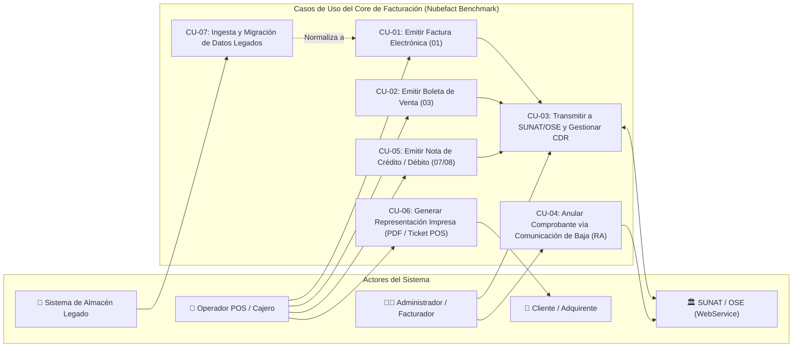
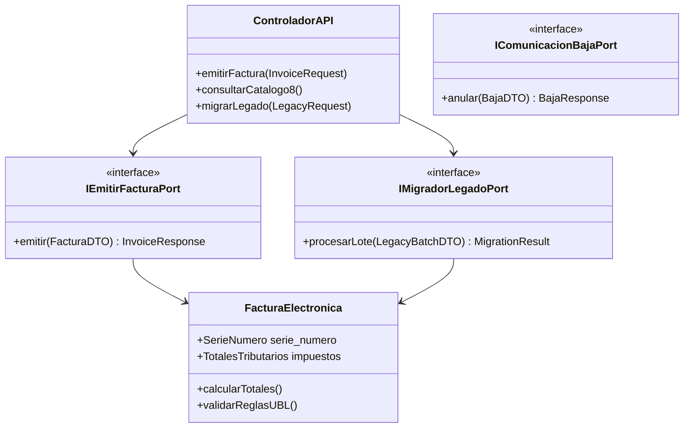

# 💼 Especificación Formal de Casos de Uso (Benchmark Nubefact)

* **Organización:** ABC Software Corp
* **Módulo:** Core de Facturación Electrónica UBL 2.1
* **Referencia de Industria:** Benchmark funcional de plataformas líderes de facturación electrónica en el Perú (ej. **Nubefact**, **Efact**, **TCI**).
* **Marco Normativo:** **RS Nº 097-2012/SUNAT**, **RS Nº 234-2006/SUNAT**, **RS Nº 193-2020/SUNAT** y **Ley Nº 30884**.
* **Entregable:** Sección 3 del Examen (Ciclo de Vida Transaccional y Casos de Uso).

---

## 1. Diagrama General de Casos de Uso (Mermaid.js)

---

## 2. Matriz de Cobertura Funcional (Benchmark Nubefact vs. ABC Software Corp)

| ID Caso de Uso | Caso de Uso | Capacidad Homóloga Nubefact | Endpoint API Vinculado | Estado de Implementación |
|:---|:---|:---|:---|:---:|
| **CU-01** | Emisión de Facturas Electrónicas | `POST /v1/invoice` | `POST /api/v1/facturas` | **Especificado 100%** |
| **CU-02** | Emisión de Boletas de Venta | `POST /v1/invoice` (tipo 03) | `POST /api/v1/facturas` | **Especificado 100%** |
| **CU-03** | Transmisión WebService y CDR | Envío automático / sincronización | `POST /api/v1/facturas` (respuesta CDR) | **Especificado 100%** |
| **CU-04** | Anulación / Comunicación de Baja | `POST /v1/void` | `POST /api/v1/comprobantes/baja` | **Especificado 100%** |
| **CU-05** | Notas de Crédito y Débito | `POST /v1/credit-note` | `POST /api/v1/notas` | **Especificado 100%** |
| **CU-06** | Representación Impresa (PDF/Ticket) | Generación A4 / Ticket 80mm/58mm | Generado localmente en MSI / APK | **Especificado 100%** |
| **CU-07** | Ingesta y Migración de Datos Legados | Importador masivo Excel / CSV | `POST /api/v1/migracion/legacy` | **Especificado 100%** |

---

## 3. Especificación Detallada de los Casos de Uso

### CU-01: Emisión y Firma de Facturas Electrónicas (Tipo 01 - UBL 2.1)
* **Actor Principal:** Operador POS / Facturador.
* **Precondiciones:** Emisor configurado con certificado digital X.509 activo y correlativo reservado.
* **Flujo Principal (Happy Path):**
  1. El operador ingresa los datos de la venta: RUC del receptor (11 dígitos), moneda, líneas de detalle (producto, cantidad, precio).
  2. El sistema valida el RUC del receptor mediante algoritmo de Módulo 11 y verifica que se encuentre activo y habido.
  3. El motor liquida los tributos:
     - Base Imponible Gravada ($\text{ValorVenta} = \text{round}(\text{Cantidad} \times \text{PrecioUnitarioSinIGV}, 2)$).
     - IGV ($\text{TaxAmount} = \text{round}(\text{BaseImponible} \times 0.18, 2)$).
     - Si incluye productos con ISC o bolsas plásticas (ICBPER), calcula según reglas específicas.
  4. El sistema construye el árbol XML canónico `UBL-Invoice-2.1.xsd`.
  5. El adaptador criptográfico canonicaliza (C14N) e inserta la firma XMLDSig en `ext:UBLExtensions`, computando el `DigestValue` (SHA-256) y el `SignatureValue`.
  6. Se genera la cadena oficial para el código QR de 10 campos según Anexo 8 de la RS 097-2012.
  7. El comprobante se persiste con estado `FIRMADO_LOCAL` listo para ser transmitido o impreso.
* **Flujos Alternativos:**
  - *3a. Transacción a Crédito:* El operador ingresa fecha de vencimiento y detalle de cuotas. El sistema genera los nodos `cac:PaymentTerms`.
  - *5a. Contingencia Offline (MSI en Windows / APK en Android):* Si no hay conexión de red, la factura queda sellada localmente en SQLite, se imprime el ticket con el código QR y DigestValue, y se encola en el *SyncWorker*.

---

### CU-02: Emisión de Boletas de Venta Electrónicas (Tipo 03)
* **Actor Principal:** Operador POS / Cajero de Tienda.
* **Flujo Principal:**
  1. El cajero ingresa los productos vendidos y el medio de pago (Efectivo, Tarjeta, Yape/Plin).
  2. Si el importe total es menor a **S/ 700.00**, el documento del receptor es opcional (`tipoDoc="0"`, `doc="-"`).
  3. Si el importe total es **igual o mayor a S/ 700.00**, el sistema exige obligatoriamente la identificación del cliente (DNI de 8 dígitos según Catálogo 06).
  4. Se asigna la serie electrónica iniciada en `B` (ej. `B001-00000543`).
  5. Se firma el XML UBL 2.1 y se genera la representación física para el cliente.
* **Regla de Negocio SUNAT:** Las boletas de venta pueden enviarse individualmente (`sendBill`) o consolidarse en un Resumen Diario de Boletas (`sendSummary` con prefijo `RC`).

---

### CU-03: Transmisión WebService a SUNAT/OSE y Gestión de CDR
* **Actor:** Motor de Despacho Asíncrono / Sync Worker.
* **Precondiciones:** Comprobante en estado `FIRMADO_LOCAL`.
* **Flujo Principal:**
  1. El sistema empaqueta el XML firmado en un archivo ZIP con la nomenclatura canónica: `[RUC]-[TIPO]-[SERIE]-[NUMERO].zip`.
  2. Se codifica el ZIP en Base64 y se construye el sobre SOAP 1.1 con cabecera `wsse:Security` (RUC + UsuarioSOL y ClaveSOL).
  3. Se invoca la operación síncrona `sendBill(fileName, contentFile)` contra el endpoint de SUNAT/OSE.
  4. SUNAT/OSE procesa y devuelve el archivo `R-[RUC]-[TIPO]-[SERIE]-[NUMERO].zip` conteniendo la Constancia de Recepción (CDR).
  5. El sistema desempaqueta el CDR, extrae el código numérico de respuesta y actualiza el estado:
     - **Código `0` (Aceptado):** El comprobante tiene plena validez fiscal. Se almacena el CDR en Base64.
     - **Código `2000` a `3999` (Rechazado):** El comprobante presenta inconsistencias graves. Estado cambia a `RECHAZADO`. No genera efectos tributarios.
     - **Código `>= 4000` (Observado):** El comprobante es aceptado pero contiene advertencias. Se almacena el CDR y las glosas de observación.
* **Flujo Alternativo (Caída de Servicio / Timeout):**
  - Si la llamada SOAP devuelve error de red o timeout (`0109`), el sistema no descarta el comprobante; invoca posteriormente la operación `getStatusCdr` para recuperar el CDR sin duplicar el documento.

---

### CU-04: Anulación de Comprobantes vía Comunicación de Baja (RA)
* **Actor:** Administrador de Facturación / Contador.
* **Precondiciones:** Comprobante previamente emitido y transmitido a SUNAT. Plazo máximo de anulación: hasta **7 días calendario** contados a partir del día siguiente de la emisión.
* **Flujo Principal:**
  1. El administrador selecciona la factura electrónica a anular e ingresa el motivo formal (ej. *"Error en RUC de cliente"* o *"Operación no concretada"*).
  2. El sistema valida que el comprobante no supere los 7 días de antigüedad.
  3. Se genera el documento XML de Comunicación de Baja con identificador `RA-[YYYYMMDD]-[CORRELATIVO]`.
  4. Se firma digitalmente el XML de baja y se empaqueta en `[RUC]-RA-[YYYYMMDD]-[CORRELATIVO].zip`.
  5. Se invoca la operación SOAP `sendSummary` contra SUNAT.
  6. SUNAT responde de manera asíncrona devolviendo un identificador de lote (`ticket`).
  7. El servicio backend ejecuta consultas periódicas con `getStatus(ticket)` hasta obtener el CDR de la baja con código `0` (Baja Aceptada).
  8. El estado de la factura original se actualiza a `ANULADO`.

---

### CU-05: Emisión de Notas de Crédito (Tipo 07) y Notas de Débito (Tipo 08)
* **Actor Principal:** Facturador / Cajero.
* **Flujo Principal (Nota de Crédito):**
  1. El usuario selecciona el comprobante original de referencia (ej. `F001-00001245`).
  2. Selecciona el Tipo de Nota de Crédito según **Catálogo 09 de SUNAT**:
     - `01`: Anulación de la operación.
     - `02`: Anulación por error en el RUC.
     - `03`: Corrección por error en la descripción.
     - `04`: Descuento global.
     - `05`: Descuento por ítem.
     - `06`: Devolución total.
     - `07`: Devolución por ítem.
  3. El sistema valida que la moneda de la Nota coincida con la del documento origen.
  4. Se asocian los nodos obligatorios de referencia:
     - `cac:DiscrepancyResponse/cbc:ReferenceID`: Número de la factura modificada.
     - `cac:DiscrepancyResponse/cbc:ResponseCode`: Código del catálogo 09.
     - `cac:BillingReference/cac:InvoiceDocumentReference/cbc:ID`: Factura modificada.
  5. Se genera, firma y transmite la Nota de Crédito con serie `FC01` o `BC01`.

---

### CU-06: Generación de Representación Impresa (PDF y Ticket Térmico POS)
* **Actor:** Cliente / Cajero.
* **Flujo Principal:**
  1. Al emitirse o consultarse un comprobante, el motor de renderizado genera los formatos requeridos:
     - **Formato Ticket POS (80mm / 58mm):** Diseñado para impresión térmica rápida en puntos de venta.
     - **Formato A4:** Para envío digital por correo electrónico al cliente.
  2. Elementos normativos obligatorios impresos:
     - Logotipo y datos fiscales del emisor (RUC, Razón Social, Dirección, Código de establecimiento).
     - Serie y Correlativo en formato oficial (`FACTURA ELECTRÓNICA F001-00001245`).
     - Desglose de Operaciones Gravadas, Exoneradas, Inafectas, IGV, ISC, ICBPER y Total a Pagar.
     - Leyenda del importe en letras (Catálogo 52).
     - **Código de Barras Bidimensional QR:** Imagen generada con la cadena estándar de 10 campos delimitados por barra vertical (`|`).
     - **Valor Resumen Hash (`DigestValue`):** Primeros caracteres o cadena SHA-256 completa.
     - Leyenda legal obligatoria: *"Representación impresa de la Factura Electrónica, autorizada mediante RS 097-2012/SUNAT"*.
* **Soporte Multiplataforma:**
  - En Windows (MSI): Envío directo de comandos ESC/POS a puertos USB/COM/Red.
  - En Android (APK): Conexión mediante Bluetooth SPP a impresoras portátiles de cinturón.

---

### CU-07: Ingesta, Normalización y Migración del Sistema de Almacén Legado
* **Actor:** Sistema de Almacén Legado (Migración Batch o API).
* **Flujo Principal:**
  1. El sistema de almacén envía un lote de transacciones históricas en estructura plana (`fecha`, `ingreso`, `salida`, `producto`, `nro_documento`).
  2. El endpoint `POST /api/v1/migracion/legacy` genera un `loteId` (UUID) para seguimiento de auditoría.
  3. Para cada registro del lote:
     - Valida tipos de datos y valores no nulos.
     - Mapea el campo legado `nro_documento` a la propiedad canónica de dominio **`serie_numero`** validada con la regex oficial: `^(F|B)[A-Z0-9]{3}-(0*)[1-9][0-9]{0,7}$`.
     - Normaliza `fecha` al estándar ISO-8601 (`YYYY-MM-DD` y `HH:MM:SS`).
     - Descompone el campo `ingreso` en Base Imponible neta e IGV ($\text{Base} = \frac{\text{ingreso}}{1.18}$).
     - Convierte `salida` a cantidad facturada con unidad de medida `NIU`.
  4. Genera la entidad de dominio `FacturaElectronica` UBL 2.1 con trazabilidad de auditoría.
  5. Computa un Hash criptográfico SHA-256 (`traceHash`) del lote completo garantizando no repudio.
  6. Devuelve el reporte detallado con el total de registros procesados, fallidos y el mapeo de IDs legados vs UBL.

---

## 4. Trazabilidad con la Arquitectura MVC-Hexagonal y Contratos API

