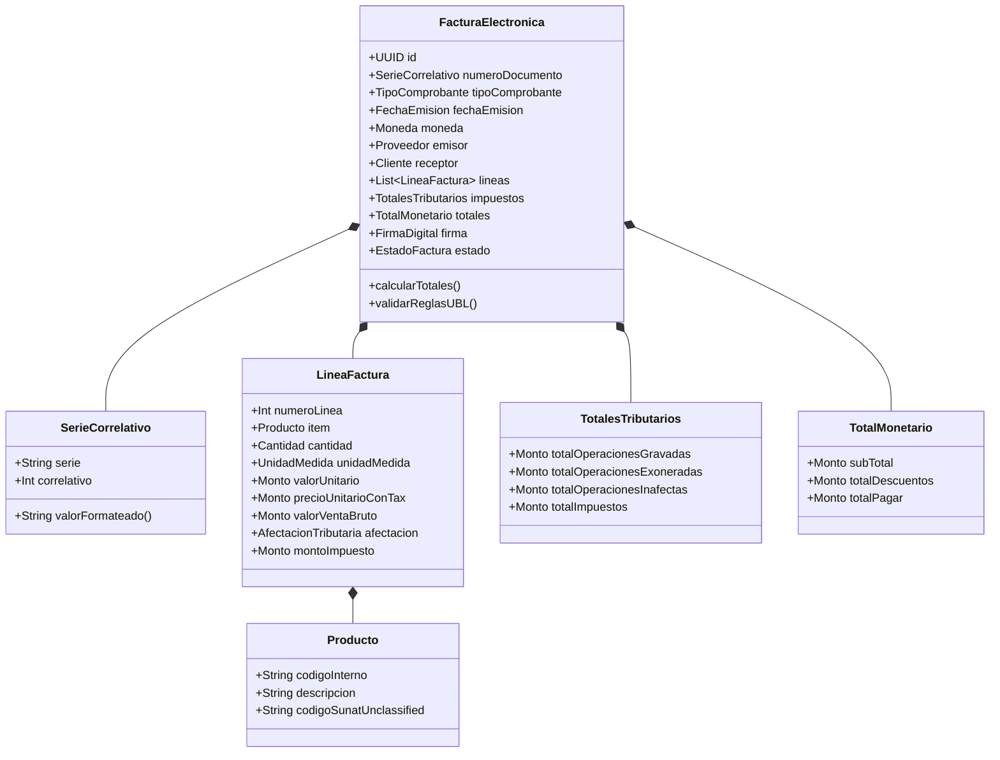

# 📦 Especificación de Dominio y Mapeo de Migración: Del Sistema Legado a UBL-Invoice-2.1

* **Módulo:** Core de Facturación Electrónica
* **Organización:** ABC Software Corp
* **Estado:** Aprobado / Especificación Oficial
* **Estándar Destino:** OASIS Universal Business Language (UBL) v2.1 (ISO/IEC 19845)
* **Plataformas Soportadas:** Windows Desktop (.MSI) y Android Móvil (.APK)

---

## 1. Contexto y Objetivos de la Migración

El sistema legado de ABC Software Corp almacena las transacciones comerciales en una estructura plana y tabular diseñada originalmente para control elemental de caja e inventario:

```sql
-- Estructura de la tabla transaccional del sistema legado
CREATE TABLE movimientos_legado (
    fecha          VARCHAR(30),   -- Fecha en formatos mixtos ("2026-10-22 14:30", "22/10/2026")
    ingreso        DECIMAL(12,2), -- Importe monetario recaudado
    salida         DECIMAL(12,2), -- Cantidad física egresada de inventario
    producto       VARCHAR(255),  -- Nombre o descripción del bien
    nro_documento  VARCHAR(50)    -- Identificador manual o correlativo sin formato estándar
);
```

### Problemas Críticos del Esquema Legado:
1. **Falta de cumplimiento tributario:** El estándar UBL 2.1 exige discriminación estricta de base imponible, impuestos (IVA/IGV/ISC), códigos de exoneración, identificación formal de contribuyentes (RUC/NIT/RFC), y firma electrónica XMLDSig.
2. **Ambigüedad de tipos de datos:** Fechas sin zona horaria, ausencia de códigos de moneda (ISO 4217), y mezcla de importes brutos con impuestos.
3. **Ausencia de granularidad documental:** Una factura moderna contiene cabecera, líneas de detalle, impuestos discriminados, descuentos y totales monetarios legales.

---

## 2. Nuevo Modelo de Dominio (Domain Driven Design - DDD)

El nuevo modelo de dominio se modela a través de un **Agregado Raíz (`FacturaElectronica`)**, Entidades hijas y **Value Objects** inmutables que encapsulan la lógica de validación y cálculo fiscal.

### 2.1. Diagrama del Modelo de Dominio



---

## 3. Matriz Exhaustiva de Mapeo: Legado ➡️ UBL-Invoice-2.1

A continuación se detalla la transformación determinista de los 5 campos legados hacia el árbol XML de OASIS UBL 2.1:

| Campo Legado | Tipo Legado | Destino en UBL 2.1 (XPath / Nodo XML) | Regla de Transformación y Enriquecimiento de Negocio |
|:---|:---|:---|:---|
| **`nro_documento`** | `VARCHAR(50)` | `Invoice/cbc:ID`<br/>`Invoice/cbc:InvoiceTypeCode` | **Normalización a Serie-Correlativo:**<br/>- Si el prefijo indica factura (ej. "F"), serie = `F001` (4 caracteres alfanuméricos), correlativo formateado a 8 dígitos con padding de ceros: `F001-00001245`.<br/>- Si indica boleta, serie = `B001`, correlativo = `B001-00001245`.<br/>- `InvoiceTypeCode`: Catálogo 01 (Factura), 03 (Boleta de Venta). |
| **`fecha`** | `VARCHAR(30)` | `Invoice/cbc:IssueDate`<br/>`Invoice/cbc:IssueTime`<br/>`Invoice/cbc:DueDate` | **Descomposición Temporal ISO-8601:**<br/>- Extrae `cbc:IssueDate` en formato estricto `YYYY-MM-DD`.<br/>- Extrae `cbc:IssueTime` en formato `HH:MM:SS`.<br/>- Si la transacción es a crédito, calcula `cbc:DueDate` según las condiciones de pago pactadas. |
| **`producto`** | `VARCHAR(255)` | `cac:InvoiceLine/cac:Item/cbc:Description`<br/>`cac:InvoiceLine/cac:Item/cac:SellersItemIdentification/cbc:ID` | **Enriquecimiento del Ítem:**<br/>- Limpieza de caracteres de escape XML (`&`, `<`, `>`, `"`, `'`).<br/>- Asigna la descripción comercial a `cbc:Description`.<br/>- Extrae o mapea mediante catálogo maestro el `SellersItemIdentification/cbc:ID` (SKU).<br/>- Enriquecimiento opcional con código UNSPSC/Catálogo tributario si está parametrizado. |
| **`salida`** | `DECIMAL(12,2)` | `cac:InvoiceLine/cbc:InvoicedQuantity` | **Conversión a Cantidad Facturada:**<br/>- El valor de egreso de inventario se mapea a la cantidad del comprobante.<br/>- Incorpora el atributo mandatorio de unidad de medida internacional: `@unitCode="NIU"` (Unidad de bien) o `@unitCode="ZZ"` (Servicio).<br/>- Valida que `InvoicedQuantity > 0`. |
| **`ingreso`** | `DECIMAL(12,2)` | `cac:InvoiceLine/cbc:LineExtensionAmount`<br/>`cac:InvoiceLine/cac:Price/cbc:PriceAmount`<br/>`cac:LegalMonetaryTotal/cbc:PayableAmount` | **Discriminación Matemática de Impuestos:**<br/>En el legado, `ingreso` representa el importe bruto pagado por el cliente.<br/>- **Cálculo de Base Imponible (Valor Venta):**<br/>$$\text{ValorVenta} = \frac{\text{ingreso}}{1 + \text{TasaImpuesto}} \quad (\text{ej. } \frac{\text{ingreso}}{1.18})$$<br/>- `LineExtensionAmount` = $\text{ValorVenta}$ neto de la línea.<br/>- `PriceAmount` (Valor Unitario sin IGV) = $\frac{\text{ValorVenta}}{\text{salida}}$.<br/>- `TaxAmount` (Monto IGV) = $\text{ingreso} - \text{ValorVenta}$.<br/>- `PayableAmount` (Total a Pagar) = Suma de todos los ingresos. |

---

## 4. Definición de Contratos de Datos (DTOs / JSON Schema)

### 4.1. DTO de Entrada de Migración (Payload Legado)
```json
{
  "$schema": "https://json-schema.org/draft/2020-12/schema",
  "title": "LegacyTransactionDTO",
  "type": "object",
  "required": ["fecha", "ingreso", "salida", "producto", "nro_documento"],
  "properties": {
    "fecha": { "type": "string", "example": "2026-10-22 10:15:00" },
    "ingreso": { "type": "number", "minimum": 0.01, "example": 118.00 },
    "salida": { "type": "number", "minimum": 1, "example": 2.0 },
    "producto": { "type": "string", "minLength": 1, "example": "Licencia Antivirus Pro 1 Año" },
    "nro_documento": { "type": "string", "example": "F001-1245" }
  }
}
```

### 4.2. DTO de Dominio Canónico (UBL-Invoice-2.1 Ready)
```json
{
  "$schema": "https://json-schema.org/draft/2020-12/schema",
  "title": "UblInvoiceCanonicalDTO",
  "type": "object",
  "required": [
    "id",
    "tipoDocumento",
    "fechaEmision",
    "horaEmision",
    "moneda",
    "emisor",
    "receptor",
    "lineas",
    "totales"
  ],
  "properties": {
    "id": { "type": "string", "pattern": "^[F|B|T][A-Z0-9]{3}-[0-9]{1,8}$", "example": "F001-00001245" },
    "tipoDocumento": { "type": "string", "enum": ["01", "03", "07", "08"], "example": "01" },
    "fechaEmision": { "type": "string", "format": "date", "example": "2026-10-22" },
    "horaEmision": { "type": "string", "pattern": "^[0-9]{2}:[0-9]{2}:[0-9]{2}$", "example": "10:15:00" },
    "moneda": { "type": "string", "enum": ["PEN", "USD", "EUR"], "example": "PEN" },
    "emisor": {
      "type": "object",
      "required": ["numeroIdentificacion", "tipoIdentificacion", "razonSocial"],
      "properties": {
        "numeroIdentificacion": { "type": "string", "example": "20601234567" },
        "tipoIdentificacion": { "type": "string", "example": "6" },
        "razonSocial": { "type": "string", "example": "ABC SOFTWARE CORP S.A.C." }
      }
    },
    "receptor": {
      "type": "object",
      "required": ["numeroIdentificacion", "tipoIdentificacion", "razonSocial"],
      "properties": {
        "numeroIdentificacion": { "type": "string", "example": "20109876543" },
        "tipoIdentificacion": { "type": "string", "example": "6" },
        "razonSocial": { "type": "string", "example": "CLIENTE DE PRUEBAS S.A." }
      }
    },
    "lineas": {
      "type": "array",
      "minItems": 1,
      "items": {
        "type": "object",
        "required": [
          "numeroLinea",
          "cantidad",
          "unidadMedida",
          "descripcion",
          "valorUnitario",
          "precioUnitarioConImpuesto",
          "valorVenta",
          "montoImpuesto",
          "codigoAfectacionIGV"
        ],
        "properties": {
          "numeroLinea": { "type": "integer", "minimum": 1, "example": 1 },
          "cantidad": { "type": "number", "minimum": 0.0001, "example": 2.0 },
          "unidadMedida": { "type": "string", "example": "NIU" },
          "descripcion": { "type": "string", "example": "Licencia Antivirus Pro 1 Año" },
          "valorUnitario": { "type": "number", "example": 50.00 },
          "precioUnitarioConImpuesto": { "type": "number", "example": 59.00 },
          "valorVenta": { "type": "number", "example": 100.00 },
          "montoImpuesto": { "type": "number", "example": 18.00 },
          "codigoAfectacionIGV": { "type": "string", "example": "10" }
        }
      }
    },
    "totales": {
      "type": "object",
      "required": [
        "totalOperacionesGravadas",
        "totalImpuestos",
        "totalPagar"
      ],
      "properties": {
        "totalOperacionesGravadas": { "type": "number", "example": 100.00 },
        "totalOperacionesExoneradas": { "type": "number", "default": 0.00 },
        "totalOperacionesInafectas": { "type": "number", "default": 0.00 },
        "totalImpuestos": { "type": "number", "example": 18.00 },
        "totalPagar": { "type": "number", "example": 118.00 }
      }
    }
  }
}
```

---

## 5. Implementación del Servicio de Migración (Mapping Engine)

El servicio `MigradorLegadoUblService` reside en la capa de **Aplicación** y orquesta la transformación:

```typescript
// src/application/services/migrador-legado-ubl.service.ts

export class MigradorLegadoUblService {
  private readonly TASA_IGV = 0.18; // 18% para operaciones gravadas estándar

  public transformar(legado: LegacyTransactionDTO, emisorConfig: EmisorConfig): FacturaElectronica {
    // 1. Normalización de Fecha y Hora
    const { issueDate, issueTime } = this.parsearFecha(legado.fecha);

    // 2. Descomposición Financiera: ingreso = Total a Pagar con impuesto
    const totalPagar = legado.ingreso;
    const totalValorVenta = Number((totalPagar / (1 + this.TASA_IGV)).toFixed(2));
    const totalImpuesto = Number((totalPagar - totalValorVenta).toFixed(2));

    // 3. Cálculo de Línea
    const cantidad = legado.salida;
    const valorUnitario = Number((totalValorVenta / cantidad).toFixed(4));
    const precioUnitarioConTax = Number((totalPagar / cantidad).toFixed(4));

    // 4. Instanciación del Agregado de Dominio
    return FacturaElectronica.crear({
      numeroDocumento: SerieCorrelativo.crearDesdeString(legado.nro_documento),
      tipoDocumento: TipoComprobante.determinarDesdeSerie(legado.nro_documento),
      fechaEmision: issueDate,
      horaEmision: issueTime,
      moneda: Moneda.PEN,
      emisor: emisorConfig,
      receptor: Cliente.crearConsumidorFinal(), // Default para transacciones legadas de mostrador
      lineas: [
        new LineaFactura({
          numeroLinea: 1,
          descripcion: legado.producto.trim(),
          cantidad: cantidad,
          unidadMedida: UnidadMedida.NIU,
          valorUnitario: valorUnitario,
          precioUnitarioConTax: precioUnitarioConTax,
          valorVenta: totalValorVenta,
          montoImpuesto: totalImpuesto,
          codigoAfectacion: '10' // Gravado - Operación Onerosa
        })
      ],
      totales: new TotalesTributarios({
        totalGravadas: totalValorVenta,
        totalImpuestos: totalImpuesto,
        totalPagar: totalPagar
      })
    });
  }

  private parsearFecha(fechaStr: string): { issueDate: string; issueTime: string } {
    const dateObj = new Date(fechaStr.replace(/(\d{2})\/(\d{2})\/(\d{4})/, '$3-$2-$1'));
    if (isNaN(dateObj.getTime())) {
      // Fallback a fecha/hora del sistema en contingencia
      const now = new Date();
      return {
        issueDate: now.toISOString().split('T')[0],
        issueTime: now.toTimeString().split(' ')[0]
      };
    }
    return {
      issueDate: dateObj.toISOString().split('T')[0],
      issueTime: dateObj.toTimeString().split(' ')[0]
    };
  }
}
```

---

## 6. Soporte de Empaquetación Multiplataforma (MSI en Windows y APK en Android)

La migración hacia UBL 2.1 requiere que las aplicaciones empaquetadas en **MSI** y **APK** puedan operar bajo escenarios de red inestables o completamente offline sin romper la integridad tributaria:

### 6.1. Windows Desktop (.MSI)
- **Migración Batch y Concurrencia:** Las cajas POS instaladas con el archivo MSI procesan la importación masiva de tablas legadas mediante SQLite o conexión local LAN sin saturar la red.
- **Impresión de Comprobante:** El instalador MSI incluye el generador del código de resumen Hash SHA-256 (`cbc:DigestValue`) y código QR localmente, permitiendo imprimir de inmediato el ticket fiscal térmico (ESC/POS) antes de transmitir a la autoridad tributaria.

### 6.2. Android Mobile (.APK)
- **Persistencia Local y Sincronización:** El APK en terminales móviles Android de campo almacena los registros transformados en una base de datos local embebida (SQLite / Room).
- **Procesamiento Ligero:** El mapeador de dominio UBL está optimizado para ejecutarse en dispositivos móviles con memoria limitada (bajo uso de reflection, serialización JSON nativa).
- **Emisión en Modo Contingencia:** Si un vendedor no cuenta con cobertura celular, la aplicación Android genera la factura electrónica válida UBL 2.1, estampa el correlativo local reservado, imprime el ticket por Bluetooth y encola el comprobante en el *SyncWorker* para su transmisión en cuanto haya señal de red.
