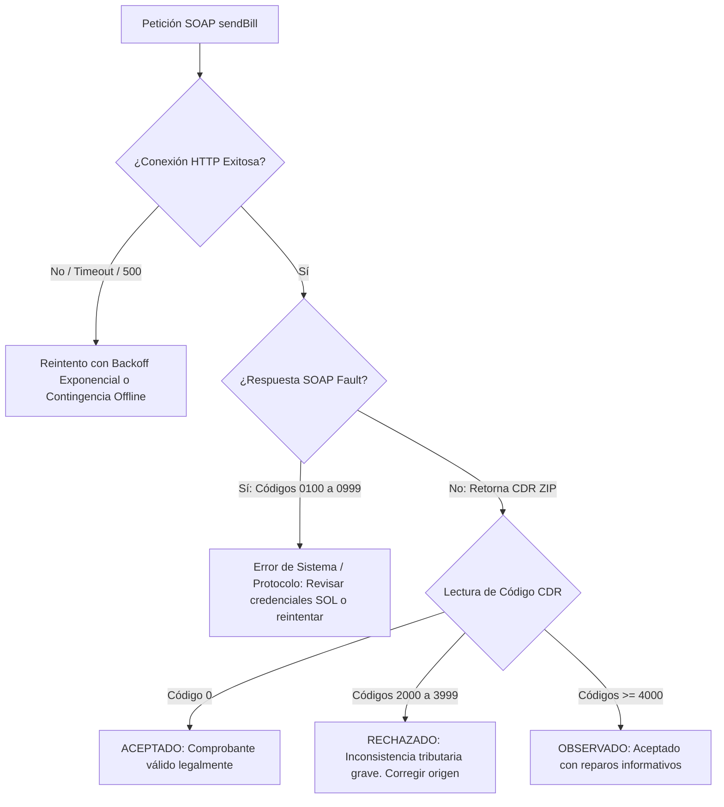

# 📊 Matriz de Trazabilidad Normativa: SUNAT ➡️ OASIS UBL-Invoice-2.1

* **Organización:** ABC Software Corp
* **Módulo:** Core de Facturación Electrónica y Motor de Validaciones
* **Marco Legal y Técnico:**
  * **RS Nº 097-2012/SUNAT** y modificatorias (Sistema de Emisión Electrónica SEE-DSC y SEE-OSE).
  * **RS Nº 234-2006/SUNAT** (Reglamento de Comprobantes de Pago y Libros Vinculados).
  * **Ley Nº 30884** (Impuesto al Consumo de Bolsas de Plástico - ICBPER).
  * **OASIS Universal Business Language (UBL) 2.1** (ISO/IEC 19845).
* **Propósito:** Guía de implementación formal y libre de ambigüedades para desarrolladores backend, ingenieros de QA y arquitectos de software encargados de programar las validaciones del motor fiscal.

---

## 1. Guía de Convenciones y Reglas Generales de Tipado

Antes de consultar la matriz, considere las siguientes directrices obligatorias de la SUNAT:
1. **Redondeo Numérico:**
   - Precios unitarios y valores unitarios: hasta **10 decimales** (mínimo 2, típicamente 4 para retail o 6 para hidrocarburos/granel).
   - Cantidades físicas: hasta **10 decimales** (mínimo 2 o 4 según unidad de medida).
   - Montos totales, bases imponibles e impuestos: redondeo bancario a **2 decimales**.
2. **Fórmula de Cuadre Aritmético:**
   $$\text{PayableAmount} = \text{LineExtensionAmount} + \sum \text{TaxAmount (IGV + ISC + ICBPER)} - \text{AllowanceTotalAmount} + \text{ChargeTotalAmount}$$
3. **Módulo 11 (Algoritmo de Validación RUC):**
   - El RUC debe ser una cadena de 11 dígitos numéricos donde el último dígito es el residuo ponderado de los factores `[5, 4, 3, 2, 7, 6, 5, 4, 3, 2]`.

---

## 2. Matriz Exhaustiva de Trazabilidad

### 2.1. Metadatos de Cabecera y Configuración del Documento

| Requerimiento Normativo SUNAT | Catálogo SUNAT | XPath / Elemento UBL 2.1 | Regla de Validación y Restricción Técnica (Backend) | Código Error SUNAT |
|:---|:---|:---|:---|:---|
| **Versión del Estándar UBL** | N/A | `/Invoice/cbc:UBLVersionID` | **Valor Fijo:** `"2.1"`. Obligatorio. Tipo `string`. Rechaza si es `"2.0"`. | 2115 |
| **Personalización del Estándar** | N/A | `/Invoice/cbc:CustomizationID` | **Valor Fijo:** `"2.0"`. Obligatorio. Define las reglas de negocio de SUNAT para UBL 2.1. | 2116 |
| **Tipo de Operación** | Catálogo 51 / 17 | `/Invoice/cbc:ProfileID` | **Regex:** `^[0-9]{4}$`. Opcional/Recomendado. Ejemplo: `"0101"` (Venta Interna), `"0200"` (Exportación), `"1001"` (Venta sujeta a Detracción). | 2064 |
| **Serie y Correlativo** | Catálogo 08 (RS 234-2006) | `/Invoice/cbc:ID` | **Regex Factura:** `^[F][A-Z0-9]{3}-[0-9]{1,8}$`<br/>**Regex Boleta:** `^[B][A-Z0-9]{3}-[0-9]{1,8}$`<br/>Longitud total máxima: 13 caracteres. El correlativo debe normalizarse con ceros a la izquierda hasta 8 dígitos (ej. `F001-00001245`). | 1002, 1003 |
| **Fecha de Emisión** | N/A | `/Invoice/cbc:IssueDate` | Formato estricto `YYYY-MM-DD`. No puede ser posterior a la fecha actual del sistema. No puede ser anterior a **3 días calendario** en facturas (RS 097-2012). | 2108, 2109 |
| **Hora de Emisión** | N/A | `/Invoice/cbc:IssueTime` | Formato estricto `HH:MM:SS` (24 horas). Ejemplo: `"14:35:10"`. | 2110 |
| **Fecha de Vencimiento** | N/A | `/Invoice/cbc:DueDate` | Formato `YYYY-MM-DD`. Condicional: Obligatorio si la forma de pago es `"Credito"`. Debe ser igual o posterior a `cbc:IssueDate`. | 2111 |
| **Tipo de Comprobante** | Catálogo 08 | `/Invoice/cbc:InvoiceTypeCode` | **Valores Permitidos:** `"01"` (Factura), `"03"` (Boleta de Venta). Si el emisor coloca `"01"`, la serie en `cbc:ID` debe iniciar obligatoriamente con `"F"`. | 1004 |
| **Código de Moneda** | Catálogo 01 (ISO 4217) | `/Invoice/cbc:DocumentCurrencyCode` | **Valores Permitidos:** `"PEN"` (Soles), `"USD"` (Dólares americanos), `"EUR"` (Euros). Tipo `string` de 3 caracteres. | 2072 |
| **Leyendas Tributarias** | Catálogo 52 | `/Invoice/cbc:Note` | Elemento repetitivo con atributo obligatorio `@languageLocaleID="XXXX"`, donde `XXXX` es el código del catálogo 52 (ej. `"1000"` para monto en letras). | 2068 |

---

### 2.2. Firma Digital y Extensiones Criptográficas

| Requerimiento Normativo SUNAT | Catálogo SUNAT | XPath / Elemento UBL 2.1 | Regla de Validación y Restricción Técnica (Backend) | Código Error SUNAT |
|:---|:---|:---|:---|:---|
| **Contenedor de Extensiones UBL** | N/A | `/Invoice/ext:UBLExtensions` | Nodo raíz que encapsula la firma digital X.509 estándar W3C XMLDSig. | 2117 |
| **Punto de Anclaje de Firma** | N/A | `ext:UBLExtension/ext:ExtensionContent/ds:Signature` | Estructura canónica XMLDSig. Debe poseer atributo `Id="SignABCSoftware"` o similar. | 2118 |
| **Resumen Criptográfico (Digest)** | N/A | `ds:Signature/ds:SignedInfo/ds:Reference/ds:DigestValue` | String en Base64 que representa el Hash **SHA-256** del XML canónico sin firmar. Debe imprimirse en el ticket POS. | 2119 |
| **Valor de la Firma** | N/A | `ds:Signature/ds:SignatureValue` | String en Base64 resultante de cifrar el Digest con la clave privada RSA (2048 bits mínimo) del certificado digital. | 2120 |
| **Certificado X.509** | N/A | `ds:Signature/ds:KeyInfo/ds:X509Data/ds:X509Certificate` | Cadena en Base64 del certificado X.509 emitido por una entidad de certificación acreditada ante INDECOPI. El RUC del certificado debe coincidir exactamente con el RUC emisor. | 2121, 2122 |

---

### 2.3. Datos del Emisor (AccountingSupplierParty)

| Requerimiento Normativo SUNAT | Catálogo SUNAT | XPath / Elemento UBL 2.1 | Regla de Validación y Restricción Técnica (Backend) | Código Error SUNAT |
|:---|:---|:---|:---|:---|
| **RUC del Emisor** | Catálogo 06 | `cac:AccountingSupplierParty/cac:Party/cac:PartyIdentification/cbc:ID` | **Validación Estricta:** 11 dígitos numéricos. Prefijo debe ser `10`, `20`, `15`, `16` o `17`. Debe validar el algoritmo de Módulo 11. Atributo `@schemeID="6"`. | 1034, 1035 |
| **Tipo Documento Emisor** | Catálogo 06 | `.../cac:PartyIdentification/cbc:ID/@schemeID` | **Valor Fijo:** `"6"` (RUC). Ningún otro tipo de documento está permitido para el emisor de una factura. | 1036 |
| **Razón Social del Emisor** | N/A | `cac:Party/cac:PartyLegalEntity/cbc:RegistrationName` | Tipo `string`. Mínimo 2 caracteres, máximo 150. Debe coincidir con el padrón RUC vigente de SUNAT en estado **ACTIVO** y condición **HABIDO**. | 1037 |
| **Nombre Comercial** | N/A | `cac:Party/cac:PartyName/cbc:Name` | Tipo `string`. Opcional. Máximo 100 caracteres. | 1038 |
| **Código de Local Anexo** | N/A | `cac:Party/cac:PostalAddress/cbc:AddressTypeCode` | **Regex:** `^[0-9]{4}$`. Código de establecimiento asignado por SUNAT (ej. `"0000"` para local principal, `"0001"`, etc.). | 2140 |
| **Código de Ubigeo** | Catálogo 13 (INEI) | `cac:Party/cac:PostalAddress/cbc:ID` | **Regex:** `^[0-9]{6}$`. 6 dígitos correspondientes a Departamento (2), Provincia (2) y Distrito (2). Atributo `@schemeAgencyName="PE:INEI"`. | 2141 |
| **Dirección Fiscal** | N/A | `cac:PostalAddress/cac:AddressLine/cbc:Line` | Tipo `string`. Máximo 150 caracteres. | 2142 |

---

### 2.4. Datos del Adquirente / Cliente (AccountingCustomerParty)

| Requerimiento Normativo SUNAT | Catálogo SUNAT | XPath / Elemento UBL 2.1 | Regla de Validación y Restricción Técnica (Backend) | Código Error SUNAT |
|:---|:---|:---|:---|:---|
| **Número Documento Cliente** | Catálogo 06 | `cac:AccountingCustomerParty/cac:Party/cac:PartyIdentification/cbc:ID` | Si el comprobante es **Factura (01)**, el tipo debe ser obligatoriamente RUC (`schemeID="6"`, 11 dígitos válidos con Módulo 11). Si es **Boleta (03)**, permite DNI (`"1"`, 8 dígitos), Carnet Ext. (`"4"`), Pasaporte (`"7"`), o `"0"` (sin RUC para boletas menores a S/ 700.00). | 2014, 2015 |
| **Tipo Documento Cliente** | Catálogo 06 | `.../cac:PartyIdentification/cbc:ID/@schemeID` | **Valores Permitidos:** `"6"` (RUC), `"1"` (DNI), `"4"` (Carnet Extranjería), `"7"` (Pasaporte), `"0"` (Doc. Tributario No Domiciliado). | 2016 |
| **Razón Social / Nombre** | N/A | `cac:Party/cac:PartyLegalEntity/cbc:RegistrationName` | Obligatorio si el cliente tiene RUC o si el importe total de la boleta supera los S/ 700.00. Máximo 150 caracteres. | 2017 |

---

### 2.5. Condiciones Comerciales y Forma de Pago

| Requerimiento Normativo SUNAT | Catálogo SUNAT | XPath / Elemento UBL 2.1 | Regla de Validación y Restricción Técnica (Backend) | Código Error SUNAT |
|:---|:---|:---|:---|:---|
| **Forma de Pago** | N/A (RS 193-2020) | `cac:PaymentTerms/cbc:PaymentMeansID` | **Valores Estrictos:** `"Contado"` o `"Credito"`. Obligatorio. Sensible a mayúsculas. | 2088 |
| **Monto Pendiente de Pago** | N/A | `cac:PaymentTerms/cbc:Amount` | Condicional: Obligatorio si `PaymentMeansID="Credito"`. Atributo `@currencyID` idéntico a `DocumentCurrencyCode`. Debe coincidir con la sumatoria de las cuotas. | 2089 |
| **Detalle de Cuotas** | N/A | `cac:PaymentTerms[cbc:ID="CuotaXXX"]` | Repetitivo. Cada cuota debe contener `cbc:PaymentMeansID="Cuota001"`, `cbc:Amount` (monto cuota > 0) y `cbc:PaymentDueDate` (fecha vencimiento cuota). | 2090 |

---

### 2.6. Detalle de Ítems / Líneas (`cac:InvoiceLine`)

| Requerimiento Normativo SUNAT | Catálogo SUNAT | XPath / Elemento UBL 2.1 | Regla de Validación y Restricción Técnica (Backend) | Código Error SUNAT |
|:---|:---|:---|:---|:---|
| **Número Secuencial de Línea** | N/A | `cac:InvoiceLine/cbc:ID` | Entero correlativo incremental iniciando obligatoriamente en `1` (`1, 2, 3...`). No puede haber duplicados ni saltos. | 2150 |
| **Cantidad Facturada** | N/A | `cac:InvoiceLine/cbc:InvoicedQuantity` | Decimal estrictamente positivo (`> 0`). Máximo 10 decimales. | 2151 |
| **Unidad de Medida Comercial** | Catálogo 03 | `cac:InvoiceLine/cbc:InvoicedQuantity/@unitCode` | **Valores Comunes:** `"NIU"` (Unidad/Bienes), `"KGM"` (Kilogramos), `"ZZ"` (Servicios/Mutuo acuerdo), `"MTR"` (Metros), `"LTR"` (Litros). Obligatorio según estándar UN/ECE Rec 20. | 2152 |
| **Valor de Venta Neto de Línea** | N/A | `cac:InvoiceLine/cbc:LineExtensionAmount` | **Cálculo:** $\text{LineExtensionAmount} = \text{round}(\text{InvoicedQuantity} \times \text{PriceAmount}, 2)$. Importe sin impuestos ni cargos. | 2153 |
| **Precio Unitario con Impuesto** | Catálogo 16 | `cac:PricingReference/cac:AlternativeConditionPrice/cbc:PriceAmount` | Precio de venta comercial que paga el público consumidor (incluye IGV e ISC si aplica). | 2154 |
| **Tipo de Precio Unitario** | Catálogo 16 | `.../cac:AlternativeConditionPrice/cbc:PriceTypeCode` | **Valor:** `"01"` (Precio unitario incluye impuestos). En transferencias gratuitas se usa `"02"` (Valor referencial unitario). | 2155 |
| **Valor Unitario sin Impuestos** | N/A | `cac:InvoiceLine/cac:Price/cbc:PriceAmount` | Valor monetario por unidad sin ningún tipo de impuesto. Obligatorio. | 2156 |
| **Descripción del Ítem** | N/A | `cac:InvoiceLine/cac:Item/cbc:Description` | Tipo `string`. Mínimo 1 carácter, máximo 500. Prohibido caracteres nulos o entidades XML mal formadas. | 2157 |
| **Código Interno (SKU)** | N/A | `cac:Item/cac:SellersItemIdentification/cbc:ID` | Tipo `string`. Opcional/Recomendado. Máximo 30 caracteres alfanuméricos. | 2158 |
| **Código Producto SUNAT** | Catálogo 25 (UNSPSC) | `cac:Item/cac:CommodityClassification/cbc:ItemClassificationCode` | **Regex:** `^[0-9]{8}$`. Código de 8 dígitos según estándar UNSPSC. Obligatorio para adquisiciones del Estado peruano. | 2159 |

---

### 2.7. Impuestos Específicos: IGV, ISC e ICBPER

| Tributo | Catálogo SUNAT | XPath / Elemento UBL 2.1 | Reglas de Cálculo y Validación Técnica | Código Error SUNAT |
|:---|:---|:---|:---|:---|
| **IGV - Impuesto General a las Ventas** | Catálogo 05 (`"1000"`)<br/>Catálogo 07 (Afectación) | `cac:TaxTotal/cac:TaxSubtotal`<br/>`cbc:TaxableAmount`<br/>`cbc:TaxAmount`<br/>`cac:TaxCategory/cbc:Percent`<br/>`cac:TaxCategory/cbc:TaxExemptionReasonCode`<br/>`cac:TaxScheme/cbc:ID="1000"`<br/>`cac:TaxScheme/cbc:Name="IGV"`<br/>`cac:TaxScheme/cbc:TaxTypeCode="VAT"` | **Reglas de Afectación (Catálogo 07):**<br/>- Si `TaxExemptionReasonCode="10"` (Gravado Oneroso):<br/>  $\text{TaxAmount} = \text{round}(\text{TaxableAmount} \times 0.18, 2)$.<br/>  `Percent` = `18.00` (o `10.00` en regímenes especiales).<br/>- Si es Exonerado (`"20"`), Inafecto (`"30"`) o Exportación (`"40"`):<br/>  $\text{TaxAmount} = 0.00$, $\text{Percent} = 0.00$.<br/>- En transferencias gratuitas (`"11"` a `"17"`), el impuesto es referencial y debe asociarse a leyenda `1002`. | 2160, 2161, 2162 |
| **ISC - Impuesto Selectivo al Consumo** | Catálogo 05 (`"2000"`)<br/>Catálogo 08 (Sistemas de ISC) | `cac:TaxTotal/cac:TaxSubtotal`<br/>`cbc:TaxableAmount`<br/>`cbc:TaxAmount`<br/>`cac:TaxCategory/cbc:TierRange`<br/>`cac:TaxScheme/cbc:ID="2000"`<br/>`cac:TaxScheme/cbc:Name="ISC"`<br/>`cac:TaxScheme/cbc:TaxTypeCode="EXC"` | **Sistemas de Cálculo (`TierRange`):**<br/>- `"01"` (Sistema al Valor):<br/>  $\text{TaxAmount} = \text{round}(\text{TaxableAmount} \times \frac{\text{Percent}}{100}, 2)$.<br/>- `"02"` (Monto Fijo por Unidad Física):<br/>  $\text{TaxAmount} = \text{round}(\text{InvoicedQuantity} \times \text{FactorFijo}, 2)$.<br/>- `"03"` (Precio Venta al Público):<br/>  Aplica sobre el PVP sugerido. | 2163, 2164 |
| **ICBPER - Bolsas Plásticas** | Catálogo 05 (`"7152"`)<br/>Ley Nº 30884 | `cac:TaxTotal/cac:TaxSubtotal`<br/>`cbc:TaxAmount`<br/>`cac:TaxCategory/cbc:BaseUnitMeasure`<br/>`cac:TaxCategory/cac:TaxScheme/cbc:ID="7152"`<br/>`cac:TaxCategory/cac:TaxScheme/cbc:Name="ICBPER"`<br/>`cac:TaxCategory/cac:TaxScheme/cbc:TaxTypeCode="OTH"` | **Cálculo por Unidad Física:**<br/>- `BaseUnitMeasure`: Entero que indica la cantidad de bolsas de plástico despachadas.<br/>- $\text{TaxAmount} = \text{BaseUnitMeasure} \times \text{TarifaVigente}$ (Ej. S/ 0.50 por bolsa).<br/>- No tiene base imponible porcentual (`TaxableAmount` se omite o es cero). | 2165, 2166 |

---

### 2.8. Totales Globales del Comprobante (`cac:LegalMonetaryTotal`)

| Requerimiento Normativo SUNAT | Catálogo SUNAT | XPath / Elemento UBL 2.1 | Regla de Validación y Restricción Técnica (Backend) | Código Error SUNAT |
|:---|:---|:---|:---|:---|
| **Total Valor de Venta (Neto)** | N/A | `cac:LegalMonetaryTotal/cbc:LineExtensionAmount` | Sumatoria exacta de todos los `LineExtensionAmount` de las líneas. Representa la base imponible total acumulada. | 2170 |
| **Total Precio de Venta (Con Impuestos)** | N/A | `cac:LegalMonetaryTotal/cbc:TaxInclusiveAmount` | Suma de `LineExtensionAmount` + Total de Impuestos (`IGV + ISC + ICBPER`). | 2171 |
| **Total Descuentos Globales** | N/A | `cac:LegalMonetaryTotal/cbc:AllowanceTotalAmount` | Descuentos globales que no afectan directamente la base de una sola línea. Default: `0.00`. | 2172 |
| **Total Otros Cargos** | N/A | `cac:LegalMonetaryTotal/cbc:ChargeTotalAmount` | Gastos adicionales no tributarios cargados al cliente (fletes, seguros). Default: `0.00`. | 2173 |
| **Total Anticipos Aplicados** | N/A | `cac:LegalMonetaryTotal/cbc:PrepaidAmount` | Anticipos deducidos vinculados mediante comprobante previo. Default: `0.00`. | 2174 |
| **Importe Total a Pagar** | N/A | `cac:LegalMonetaryTotal/cbc:PayableAmount` | **Validación Crucial:** Debe coincidir exactamente con:<br/>$\text{LineExtensionAmount} + \sum \text{Impuestos} - \text{AllowanceTotalAmount} + \text{ChargeTotalAmount} - \text{PrepaidAmount}$. En Soles (`PEN`) o Dólares (`USD`). | 2175 |

---

### 2.9. Representación Impresa y Resumen de Trazabilidad (Ticket POS / QR)

| Elemento Requerido | Norma Legal | Fuente de Datos UBL 2.1 | Formato Canónico y Regla de Generación |
|:---|:---|:---|:---|
| **Cadena para Código QR** | Anexo 8 - RS 097-2012 | Varios elementos de `/Invoice` | Cadena concatenada por el carácter barra vertical (`\|`) con 10 campos obligatorios:<br/>`RUC Emisor\|Tipo Doc\|Serie\|Correlativo\|Total IGV\|Total Venta\|Fecha Emisión\|Tipo Doc Cliente\|Nro Doc Cliente\|DigestValue`<br/>*Ejemplo:* `20601234567\|01\|F001\|00001245\|18.00\|118.00\|2026-10-22\|6\|20109876543\|47DEQpj8HBSa+/TImW+5JCeuQeRkm5NMpJWZG3hSuFU=` |
| **Código Hash Resumen** | RS 097-2012 | `ds:Reference/ds:DigestValue` | Primeros 8 caracteres o valor completo impreso en el ticket (ej. `Hash: 47DEQpj8...`). |
| **Leyenda en Letras** | Catálogo 52 (Código 1000) | `/Invoice/cbc:Note[@languageLocaleID="1000"]` | Conversión determinista del `PayableAmount` a palabras (ej. `"SON: CIENTO DIECIOCHO CON 00/100 SOLES"`). |

---

---

## 3. Integración WebServices y Empaquetado SUNAT (Manual del Programador 2021)

### 3.1. Estructura y Reglas del Paquete ZIP
Para la transmisión electrónica mediante el servicio web `sendBill` de SUNAT/OSE, el archivo XML firmado debe ser empaquetado en un archivo comprimido ZIP bajo las siguientes reglas estrictas:

* **Nomenclatura Canónica:**
  * **XML Comprobante:** `[RUC]-[TIPO]-[SERIE]-[NUMERO].xml` *(Ejemplo: `20601234567-01-F001-00001245.xml`)*.
  * **ZIP Comprimido:** `[RUC]-[TIPO]-[SERIE]-[NUMERO].zip` *(Ejemplo: `20601234567-01-F001-00001245.zip`)*.
  * **Constancia de Recepción (CDR):** `R-[RUC]-[TIPO]-[SERIE]-[NUMERO].zip` conteniendo en su interior el archivo XML `R-[RUC]-[TIPO]-[SERIE]-[NUMERO].xml`.
* **Reglas de Compresión:**
  1. El archivo ZIP debe contener en su directorio raíz **únicamente** el archivo XML correspondiente.
  2. Prohibido incluir carpetas intermedias o archivos temporales (`.DS_Store`, `Thumbs.db`).
  3. Algoritmo de compresión obligatorio: **Deflate** (PKZIP estándar).
  4. Codificación del XML: `ISO-8859-1` o `UTF-8` sin BOM (*Byte Order Mark*).
  5. El ZIP generado se codifica en **Base64** para su inclusión en el parámetro `contentFile` del sobre SOAP.

---

### 3.2. Estructura Canónica de la Firma XMLDSig (`ext:UBLExtensions`)
La firma digital debe incrustarse en el primer nodo `ext:UBLExtension` del árbol XML conforme al estándar W3C XML Signature Syntax and Processing:

```xml
<ext:UBLExtensions>
  <ext:UBLExtension>
    <ext:ExtensionContent>
      <ds:Signature Id="SignABCSoftware">
        <ds:SignedInfo>
          <ds:CanonicalizationMethod Algorithm="http://www.w3.org/TR/2001/REC-xml-c14n-20010315"/>
          <ds:SignatureMethod Algorithm="http://www.w3.org/2000/09/xmldsig#rsa-sha1"/>
          <ds:Reference URI="">
            <ds:Transforms>
              <ds:Transform Algorithm="http://www.w3.org/2000/09/xmldsig#enveloped-signature"/>
            </ds:Transforms>
            <ds:DigestMethod Algorithm="http://www.w3.org/2000/09/xmldsig#sha1"/>
            <ds:DigestValue>47DEQpj8HBSa+/TImW+5JCeuQeRkm5NMpJWZG3hSuFU=</ds:DigestValue>
          </ds:Reference>
        </ds:SignedInfo>
        <ds:SignatureValue>
          MIIEowIBAAKCAQEA0u9h4F...[Firma Criptográfica RSA en Base64]...
        </ds:SignatureValue>
        <ds:KeyInfo>
          <ds:X509Data>
            <ds:X509Certificate>
              MIIFXTCCA0WgAwIBAgIQ...[Certificado Público X.509 en Base64]...
            </ds:X509Certificate>
          </ds:X509Data>
        </ds:KeyInfo>
      </ds:Signature>
    </ext:ExtensionContent>
  </ext:UBLExtension>
</ext:UBLExtensions>
```

* **Reglas de Firma Digital:**
  * **Transformación `enveloped-signature`:** Garantiza que la firma se calcula sobre todo el comprobante excluyendo el nodo `<ds:Signature>`.
  * **Canonicalización C14N:** Transforma el XML a su forma canónica para que diferencias insignificantes (espacios, saltos de línea CRLF/LF) no alteren el Hash.
  * **Hash Resumen (`DigestValue`):** Valor SHA-1 o SHA-256 en Base64 que debe extraerse para la impresión del ticket POS y el código QR.
  * **Certificado Digital X.509:** Emitido por una entidad de certificación acreditada ante INDECOPI (Llamasoft, Reniec, Camerfirma, etc.). Su RUC debe coincidir con el RUC emisor.

---

### 3.3. Servicios Web SOAP, WS-Security y Manejo de Excepciones SOAP Fault

#### 3.3.1. Canales y Endpoints Oficiales
* **Producción:** `https://e-factura.sunat.gob.pe/ol-ti-itcpfegem/billService`
* **Consultas CDR:** `https://e-factura.sunat.gob.pe/ol-it-wsconscdr/billConsultService`
* **Homologación / Pruebas:** `https://e-beta.sunat.gob.pe/ol-ti-itcpfegem-beta/billService`

#### 3.3.2. Autenticación WS-Security (OASIS)
Cada petición SOAP debe incluir el encabezado de seguridad `wsse:Security`:
```xml
<soapenv:Header>
  <wsse:Security xmlns:wsse="http://docs.oasis-open.org/wss/2004/01/oasis-200401-wss-wssecurity-secext-1.0.xsd">
    <wsse:UsernameToken>
      <wsse:Username>20601234567MODDATOS</wsse:Username>
      <wsse:Password Type="http://docs.oasis-open.org/wss/2004/01/oasis-200401-wss-username-token-profile-1.0#PasswordText">moddatos</wsse:Password>
    </wsse:UsernameToken>
  </wsse:Security>
</soapenv:Header>
```

#### 3.3.3. Operaciones Web Service Principales
1. **`sendBill(fileName, contentFile)`:**
   - Envío síncrono para Facturas (`01`), Boletas (`03`) y Notas (`07`, `08`).
   - Retorna de inmediato el `applicationResponse` que contiene el archivo `R-[RUC]-[TIPO]-[SERIE]-[NUMERO].zip` con el CDR firmado.
2. **`sendSummary(fileName, contentFile)`:**
   - Envío asíncrono para Resumen Diario de Boletas (`RC`) y Comunicaciones de Baja (`RA`).
   - Retorna un identificador de lote llamado `ticket`.
3. **`getStatus(ticket)`:**
   - Consulta del estado de procesamiento de un ticket devuelto por `sendSummary`.
4. **`getStatusCdr(rucComprobante, tipoComprobante, serieComprobante, numeroComprobante)`:**
   - Consulta síncrona del estado del comprobante y recuperación/descarga de la constancia de recepción (CDR) ante caídas de conexión durante un `sendBill`.

---

### 3.4. Clasificación de Respuestas y Manejo de SOAP Fault



#### Matriz de Clasificación de Códigos de Respuesta:

| Rango de Código | Tipo de Respuesta | Significado Técnico y Tributario | Acción Requerida en Backend |
|:---|:---|:---|:---|
| **`0`** | **Aceptado** | El comprobante superó el 100% de las validaciones formales y tributarias. El CDR contiene la firma oficial de SUNAT. | Almacenar CDR en base de datos, actualizar estado a `ACEPTADO`, entregar comprobante al cliente. |
| **`0100` a `0999`** | **SOAP Fault (Error de Sistema)** | Fallo a nivel de protocolo, autenticación o servicio:<br/>- `0102`: Archivo ZIP corrupto o vacío.<br/>- `0103`: XML no coincide con el nombre del ZIP.<br/>- `0109`: Servicio no disponible / Timeout.<br/>- `0156`: RUC no habilitado en SEE.<br/>- `0160`: Usuario o Clave SOL inválidos. | **No descartar el comprobante.** Si es timeout (`0109`), reintentar con `getStatusCdr` para no duplicar correlativo. Si es error de credenciales, registrar alerta en logs. |
| **`2000` a `3999`** | **Rechazado (CDR)** | Incumplimiento grave de reglas tributarias o de esquema:<br/>- `2014`: RUC receptor no existe en padrón.<br/>- `2115`: Versión UBL incorrecta.<br/>- `2160`: Error de cuadre aritmético en IGV.<br/>- `2121`: Firma digital inválida o certificado vencido. | **Rechazo definitivo.** El comprobante no tiene validez legal. No volver a enviar con el mismo correlativo si la regla fiscal lo impide; notificar al emisor para corregir la transacción. |
| **`>= 4000`** | **Observado (CDR)** | El comprobante es **válido legalmente**, pero contiene advertencias informativas (ej. receptor con condición de no habido, o uso de catálogos desactualizados). | Almacenar el comprobante como aceptado y guardar las glosas de observación para auditoría preventiva. |

---

## 4. Guía de Implementación para Desarrolladores Backend

Para programar los validadores de negocio en el módulo `src/domain/` y `src/application/`:
1. **Paso 1 (Sintáctico):** Validar el payload contra el esquema OpenAPI [`specs/contracts/api.yaml`](../contracts/api.yaml) y verificar la regex `^(F|B)[A-Z0-9]{3}-(0*)[1-9][0-9]{0,7}$`.
2. **Paso 2 (RUC y Módulo 11):** Implementar la función de control de RUC. Si falla, lanzar excepción de dominio con código `SUNAT-1034`.
3. **Paso 3 (Afectación y Cálculos):** Si la línea tiene afectación `10`, exigir cálculo exacto de IGV con 18%.
4. **Paso 4 (Consistencia de Cuadre):** Validar la fórmula de `PayableAmount` con tolerancia máxima de $\pm 0.01$ por efecto de redondeo de líneas según Anexo 8.
5. **Paso 5 (Firma y QR):** Inyectar la firma digital en `UBLExtensions`, computar el `DigestValue` e incluir la cadena QR antes de persistir en base de datos.
6. **Paso 6 (Empaquetado y Envío):** Generar el ZIP nombrado `[RUC]-[TIPO]-[SERIE]-[NUMERO].zip`, codificar a Base64 e invocar la operación `sendBill` con cabecera WS-Security.
7. **Paso 7 (Procesamiento CDR):** Desempaquetar el CDR `R-*.zip`, evaluar el código numérico (`0`, `2000-3999`, `>=4000`) y procesar la persistencia según la matriz de estados.

